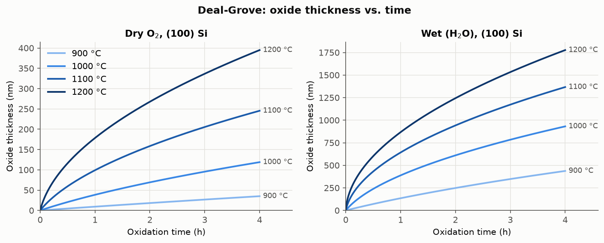
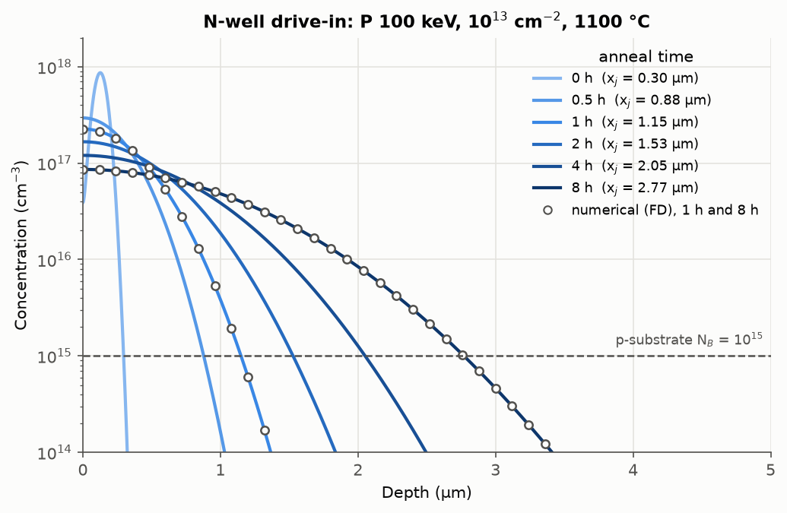
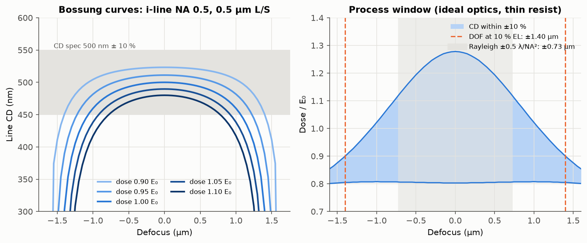

# ISRC Front-end Process Simulation

서울대학교 반도체공동연구소(ISRC) 반도체 기본공정교육에서 CMOS 소자 제작 공정을 실습한 뒤, 각 단위 공정을 물리 모델로 다시 계산해 보는 프로젝트입니다.
실습에서 다룬 장비와 공정 순서를 기준으로 모듈을 나누고, 모듈마다 **모델 구현, 교과서 및 독립 구현과의 검증, 한계 분석**을 함께 정리합니다.

## 모듈

| # | 공정 | 모델 | 상태 | 보고서 |
|---|---|---|---|---|
| 01 | 열산화 (Thermal Oxidation) | Deal-Grove, Massoud | 완료 | [docs/01_oxidation.md](docs/01_oxidation.md) |
| 02 | 이온주입 및 확산 (Ion Implantation, Drive-in) | Gaussian 분포, Fick 확산(해석해와 수치해), Masetti 이동도 | 완료 | [docs/02_implant_diffusion.md](docs/02_implant_diffusion.md) |
| 03 | 포토리소그래피 (Photolithography) | Fresnel 회절(근접 노광), Abbe 부분 결맞음 결상, 공정 창 | 완료 | [docs/03_lithography.md](docs/03_lithography.md) |
| 04 | 건식 식각 (Dry Etching) | 선형 및 이온 보조 식각 모델, level set 단면 진화, 과식각과 선택비 설계 | 완료 | [docs/04_etching.md](docs/04_etching.md) |
| 05 | 증착 및 금속배선 (CVD, PVD, Metallization) | Grove 모델, 재방출 단차 피복, 4-point probe 보정, 배선 RC 지연 | 완료 | [docs/05_deposition_metallization.md](docs/05_deposition_metallization.md) |
| 06 | 공정 통합 (Process Integration) | 누적 열처리, 문턱전압(공핍 근사), LDD 2D 측면 확산과 L_eff | 완료 | [docs/06_process_integration.md](docs/06_process_integration.md) |

## 01. 열산화 주요 결과



- 온도, 시간, 분위기(dry/wet), 결정 방향에 따른 산화막 두께를 계산하고, 목표 두께에 필요한 공정 시간을 역계산합니다.
- 공개 산화 계산기(University of Alberta nanoFAB)와 16개 조건을 비교해 최대 오차 0.063 %를 확인했습니다.
- 10 nm 게이트 산화막을 Deal-Grove 모델로만 설계하면 실제(Massoud 모델 기준) 두께가 약 2배가 됩니다. 얇은 산화막에서는 모델 선택이 공정 결과를 좌우합니다.

## 02. 이온주입 및 확산 주요 결과



- 주입 분포, 열처리 후 분포, 접합 깊이, 면저항을 한 흐름으로 계산합니다(n-well drive-in 설계 예시).
- 확산 해석해와 Crank-Nicolson 수치해가 최대 0.008 % 이내로 일치하고, 이동도 모델은 BYU 계산기와 P, As 14개 조건에서 일치합니다.
- 같은 dose라도 drive-in이 길어질수록 면저항이 낮아집니다(1651 → 755 Ω/sq). 분포가 퍼지며 최대 농도가 낮아지고 이동도가 높아지기 때문입니다.

## 03. 포토리소그래피 주요 결과



- 근접 노광은 Fresnel 회절로, 축소 투영 노광은 부분 결맞음 결상(Abbe)으로 계산하고, 레지스트 contrast와 비교해 형성 가능한 최소 패턴과 공정 창을 구합니다.
- 근접 노광의 인쇄 폭은 간격과 무관하게 W/√(λg) 하나로 정리되며, CD를 ±10 % 안으로 관리하려면 패턴이 교재의 최소 선폭 √(λg)의 약 2.1배 이상이어야 합니다.
- g-line, i-line, KrF 모두 레지스트 기준 최소 half pitch가 k₁ ≈ 0.40에서 나옵니다. k₁이 장비가 아니라 조명과 레지스트로 정해지는 공정 계수임을 보여줍니다.

## 04. 건식 식각 주요 결과


- 화학 성분과 이온 성분의 결합(선형 모델, 이온 보조 포화 모델)으로 식각 속도를 계산하고, level set 방법으로 단면이 변하는 과정을 2D로 시뮬레이션합니다. 등방성, 이방성, 선형 결합의 정확해와 비교해 검증했습니다.
- 이온 보조 식각은 화학 성분이 충분하고 이온이 속도를 제한할 때 이방성이 가장 좋고, 이온을 늘리면 오히려 이방성이 떨어집니다.
- 01 모듈의 10 nm 게이트 산화막 위 poly-Si 식각에서, 과식각 20 %로 산화막 손실을 5 nm 이하로 유지하려면 선택비가 약 27 필요합니다. 교재가 제시한 25~50과 같은 범위입니다.

## 05. 증착 및 금속배선 주요 결과


- 트렌치 안의 증착 두께를 입사각 분포(cosⁿθ)와 부착 확률(S_c), 재방출로 계산합니다. 스퍼터링은 측벽 위아래 두께가 9배 차이 나 overhang과 void가 생기기 쉽고, LPCVD W(S_c = 0.01)는 거의 균일하게 덮습니다.
- LPCVD는 저압에서 물질 전달 계수가 약 100배 커져 실제 공정 온도에서 항상 반응 율속이 되므로, 가스 흐름보다 온도(700 °C에서 1 °C당 2 %)가 균일도를 정합니다.
- 4-point probe 보정 계수를 영상법으로 계산해 Smits 식, 유한차분 해와 비교했습니다. 웨이퍼 가장자리나 작은 시료에서 4.532를 그대로 쓰면 면저항을 수~수십 % 크게 읽습니다.

## 06. 공정 통합 주요 결과


- 교재(Plummer Ch. 2)의 CMOS 공정 흐름을 01~05 모듈로 차례로 계산했습니다. LOCOS 0.52 µm(교재 약 0.5 µm), 게이트 산화막 3.4~5.6 nm(교재 3~5 nm)로 교재의 대표 결과를 재현합니다.
- 공핍 영역 안 깊이 x_i에 넣은 전하는 V_t를 (1 − x_i/W)만큼만 바꿉니다. 4 nm 게이트 산화막에서는 공핍 폭이 30~40 nm로 얕아, V_t 조절 주입도 얕아져야 합니다(B 10 keV, As 30 keV).
- 게이트 산화로 온도 +2 °C(산화막 +0.11 nm)는 V_t를 13 mV 바꿔 dose 5 % 오차(8.5 mV)보다 영향이 큽니다. LDD 측면 확산으로 L_eff는 0.5 µm에서 0.40 µm로 줄어듭니다.

## 검증 요약

| 모듈 | 독립 비교 대상 |
|---|---|
| 01 산화 | nanoFAB 공개 계산기 16개 조건 (최대 오차 0.063 %) |
| 02 이온주입과 확산 | 해석해 vs Crank-Nicolson 수치해, BYU 이동도 계산기, Plummer 교재 예제 |
| 03 포토리소그래피 | 원 겹침 면적 해석해, 3광속 해석해, Fresnel 적분 vs FFT 전파 |
| 04 건식 식각 | 등방성, 이방성, Minkowski 합 정확해와 격자 수렴 |
| 05 증착과 금속배선 | view factor 합 법칙, 입자 수지, Smits 식과 유한차분 해 |
| 06 공정 통합 | 균일 도핑 V_t 해석해, (1 − x_i/W) 관계, 2D 확산 수치해, 교재 공정 흐름의 대표 결과 |

자동 테스트는 전체 169개입니다.

## 구조

```
src/isrc_sim/        물리 모델 (constants.py에 계수와 출처)
scripts/             그래프와 결과 표 생성 스크립트
tests/               pytest 검증
data/reference/      검증용 참조 데이터
figures/, results/   생성된 그래프와 표
docs/                모듈별 보고서
```

## 실행

```bash
python -m venv .venv
.venv/bin/pip install -r requirements.txt
.venv/bin/python -m pytest
.venv/bin/python scripts/run_oxidation.py
.venv/bin/python scripts/run_implant_diffusion.py
.venv/bin/python scripts/run_lithography.py
.venv/bin/python scripts/run_etching.py
.venv/bin/python scripts/run_deposition.py
.venv/bin/python scripts/run_integration.py
```
