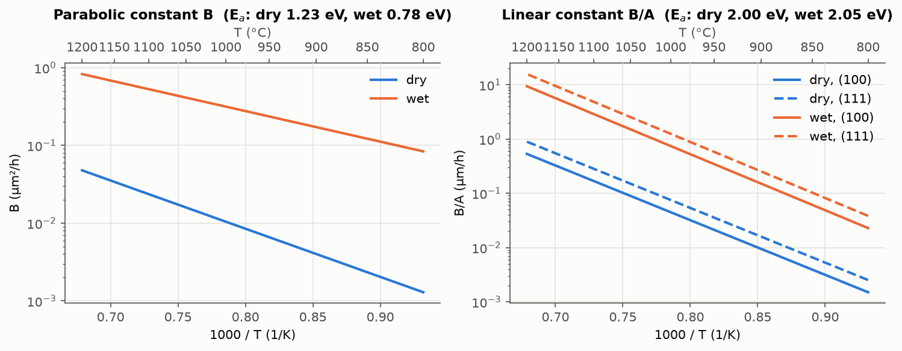
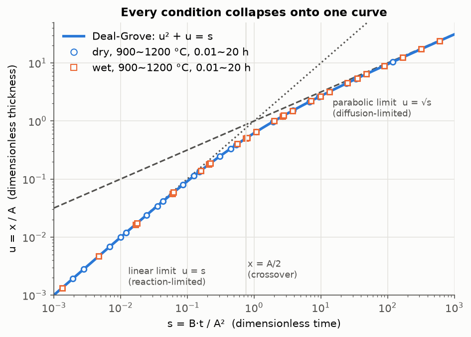
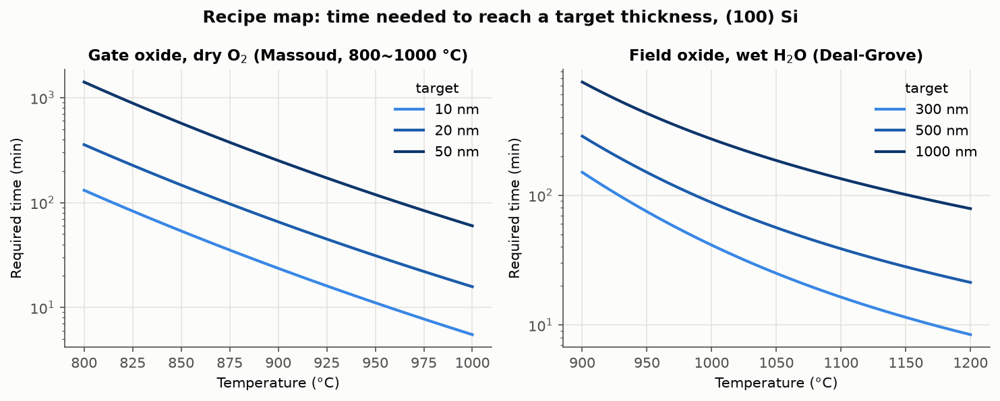
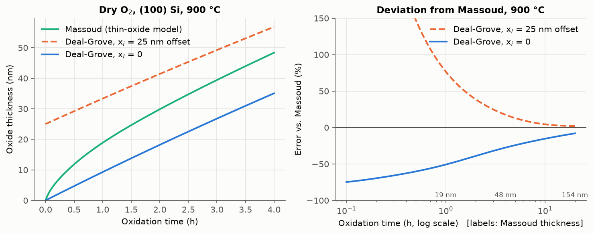
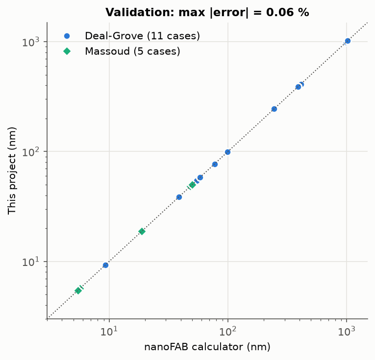

# 01. 열산화(Thermal Oxidation) 공정 시뮬레이션

## 1. 목적

서울대학교 반도체공동연구소(ISRC) 반도체 기본공정교육에서는 산화로(furnace) 공정을 진행하고, Nanospec과 Spectroscopic Ellipsometer로 산화막 두께를 측정했습니다. 이 모듈에서는 같은 공정을 물리 모델로 다시 계산합니다. 목표는 다음 세 가지입니다.

1. 온도, 시간, 분위기(dry/wet), 결정 방향이 산화막 두께를 어떻게 결정하는지 정량적으로 설명합니다.
2. 목표 두께에 필요한 공정 시간을 거꾸로 계산해 레시피 설계에 활용합니다.
3. 모델이 어느 영역에서 맞지 않는지 확인하고 그 원인을 정리합니다.

실습 당시의 레시피와 측정값은 남아 있지 않아서 교과서와 논문 계수를 기준으로 계산하고, 독립적으로 구현된 공개 계산기와 비교해 검증했습니다.

## 2. 모델

### 2.1 Deal-Grove 모델

산화제는 기체에서 산화막 표면으로 이동하고, 산화막을 통과해 확산한 뒤, Si/SiO₂ 계면에서 Si와 반응합니다. 정상 상태에서 세 단계의 플럭스가 같다고 두면 다음 식이 나옵니다.

$$x^2 + A x = B (t + \tau), \qquad \tau = \frac{x_i^2 + A x_i}{B}$$

- **B (포물선 상수)**: 산화막 내부 확산이 성장을 제한할 때의 상수입니다. 두꺼운 영역에서 $x \approx \sqrt{Bt}$가 됩니다.
- **B/A (선형 상수)**: 계면 반응이 성장을 제한할 때의 상수입니다. 얇은 영역에서 $x \approx (B/A)t$가 됩니다.
- 두 상수는 Arrhenius 식 $C \exp(-E_a/kT)$를 따릅니다.

| 분위기 | B₀ [µm²/h] | E_B [eV] | (B/A)₀ (111) [µm/h] | E_B/A [eV] |
|---|---|---|---|---|
| Dry O₂ | 7.72 × 10² | 1.23 | 6.23 × 10⁶ | 2.00 |
| Wet H₂O | 3.86 × 10² | 0.78 | 1.63 × 10⁸ | 2.05 |

출처는 Deal and Grove (1965), Jaeger (2002), Plummer et al. (2000)입니다. (100) 웨이퍼는 (B/A)₀를 1.68로 나눕니다. B는 결정 방향과 무관합니다.

### 2.2 Massoud 모델 (얇은 dry 산화막)

dry 산화 초기에는 Deal-Grove 예측보다 산화막이 훨씬 빠르게 자랍니다. Massoud 모델은 이를 지수적으로 감소하는 두 개의 가속 항으로 보정합니다.

$$x^2 + A x = B t + M_1 (1 - e^{-t/\tau_1}) + M_2 (1 - e^{-t/\tau_2}) + M_0$$

계수는 Massoud, Plummer, Irene (1985)이 (100) 웨이퍼, 800~1000 °C에서 구한 값을 사용했습니다. 적용 범위를 벗어나면 코드가 경고를 출력합니다.

## 3. 결과

### 3.1 두께와 시간의 관계


| 조건 (100), 1 h | 900 °C | 1000 °C | 1100 °C | 1200 °C |
|---|---|---|---|---|
| Dry O₂ | 9.3 nm | 38.5 nm | 99.0 nm | 178 nm |
| Wet H₂O | 135 nm | 388 nm | 642 nm | 867 nm |

1000 °C에서 wet의 B는 dry보다 약 30배, B/A는 약 17배 큽니다. H₂O가 O₂보다 SiO₂에 훨씬 많이 녹기 때문에 산화막 안의 산화제 농도가 높아지고, 그만큼 성장 속도가 빨라집니다.

### 3.2 활성화 에너지



- B의 활성화 에너지는 dry 1.23 eV, wet 0.78 eV입니다. 교재에서는 이 값을 각각 SiO₂ 안에서 O₂와 H₂O가 확산하는 활성화 에너지와 비슷한 값으로 설명합니다. B가 확산 과정을 나타낸다는 해석과 맞습니다.
- B/A의 활성화 에너지는 약 2 eV로 dry와 wet이 거의 같습니다. 계면 반응은 Si 결합을 끊는 과정이 주도하므로 산화제 종류와 크게 상관이 없다는 뜻입니다.
- (111)은 (100)보다 B/A가 1.68배 큽니다. 표면의 Si 원자 밀도가 높아 반응할 자리가 많기 때문으로 설명합니다.

### 3.3 반응 율속과 확산 율속



$u = x/A$, $s = Bt/A^2$로 무차원화하면 모든 온도와 분위기의 결과가 $u^2 + u = s$ 한 곡선 위에 놓입니다. 계면 반응 저항과 확산 저항이 같아지는 두께는 $x = A/2$입니다.

| 조건 (100) | 900 °C | 1000 °C | 1100 °C | 1200 °C |
|---|---|---|---|---|
| Dry, A/2 | 212 nm | 116 nm | 70 nm | 45 nm |
| Wet, A/2 | 568 nm | 212 nm | 91 nm | 44 nm |

공정에서 의미하는 바는 다음과 같습니다.

- 게이트 산화막(수~수십 nm)은 dry 조건의 A/2보다 훨씬 얇으므로 **반응 율속 영역**에 있습니다. 두께가 시간에 거의 비례하고, 계면 반응 속도를 정하는 온도와 결정 방향에 민감합니다. 따라서 게이트 산화 공정은 웨이퍼 내 온도 균일도 관리가 중요합니다.
- 필드 산화막(수백 nm 이상)은 wet 조건에서도 A/2보다 두꺼워 **확산 율속 영역**에 들어갑니다. 두께가 √t에 비례하므로 두께를 두 배로 키우려면 시간이 약 네 배 필요합니다.

### 3.4 레시피 설계 (역계산)



| 용도 | 분위기 | 목표 | 온도 | 사용 모델 | 필요 시간 | Deal-Grove만 쓴 경우 | Si 소모 |
|---|---|---|---|---|---|---|---|
| Gate oxide | dry | 10 nm | 900 °C | Massoud | 23.6 min | 64.7 min | 4.4 nm |
| Gate oxide | dry | 20 nm | 950 °C | Massoud | 31.2 min | 60.0 min | 8.8 nm |
| Pad / screen oxide | dry | 50 nm | 1000 °C | Massoud | 60.0 min | 81.2 min | 22.0 nm |
| Field oxide | wet | 300 nm | 1000 °C | Deal-Grove | 41.3 min | 41.3 min | 132.2 nm |
| Field oxide | wet | 500 nm | 1050 °C | Deal-Grove | 56.2 min | 56.2 min | 220.4 nm |
| Field oxide | wet | 1000 nm | 1100 °C | Deal-Grove | 134.0 min | 134.0 min | 440.7 nm |

10 nm 게이트 산화막을 Deal-Grove 계산대로 900 °C에서 64.7분 진행하면, Massoud 모델 기준으로 실제 두께는 약 19.8 nm가 됩니다. 목표의 두 배입니다. 얇은 산화막 레시피에서는 모델 선택이 곧 공정 결과를 좌우합니다.

Si 소모 비율은 Si와 SiO₂의 밀도와 몰질량으로 계산한 0.4407입니다. 500 nm 필드 산화막을 키우면 Si가 약 220 nm 소모되므로, 산화 후 Si 표면은 원래보다 낮아집니다.

### 3.5 얇은 산화막에서 Deal-Grove의 한계



900 °C dry 조건에서 Massoud 모델과 비교한 결과입니다.

| 시간 | Massoud | Deal-Grove (x_i = 0) | 오차 | Deal-Grove (x_i = 25 nm) | 오차 |
|---|---|---|---|---|---|
| 0.25 h | 7.3 nm | 2.4 nm | -68 % | 27.1 nm | +273 % |
| 1 h | 18.9 nm | 9.3 nm | -51 % | 33.3 nm | +77 % |
| 4 h | 48.4 nm | 35.1 nm | -27 % | 56.8 nm | +17 % |
| 20 h | 154.4 nm | 142.1 nm | -8 % | 157.6 nm | +2 % |

- 초기 두께를 0으로 두면 Deal-Grove는 얇은 영역을 크게 과소 예측합니다. 초기 수 nm 구간에서 실제 산화가 더 빠르게 일어나기 때문입니다.
- 교재에서 쓰는 "초기 25 nm" 보정은 두꺼운 산화막의 최종 두께를 맞추기 위한 방법입니다. 얇은 영역에서는 반대로 크게 과대 예측하므로 게이트 산화막 계산에는 맞지 않습니다.
- 1000 °C에서는 두꺼운 영역에서도 두 모델이 약 16 % 차이 납니다. 두 모델의 B 값이 서로 다른 실험 데이터로 결정되었기 때문입니다. 즉 **어떤 계수를 쓰는지도 하나의 불확도 요인**입니다.

## 4. 검증



University of Alberta nanoFAB의 [공개 산화 계산기](https://toolbox.nanofab.ualberta.ca/sithox/index.php)와 16개 조건(Deal-Grove 11개, Massoud 5개)을 비교했습니다. 최대 오차는 0.063 %이며, 계산기가 0.1 Å 단위로 반올림해 출력하는 수준의 차이입니다. 전체 비교표는 [`results/oxidation/validation_vs_nanofab.csv`](../results/oxidation/validation_vs_nanofab.csv)에 있습니다.

검증 과정에서 확인한 두 가지 사항입니다.

1. **Massoud 시정수의 부호**: 계수를 옮겨 온 자료(참고 문헌 5)에는 시정수 식이 τ = τ₀ exp(−E/kT)로 적혀 있습니다. 이 식을 그대로 쓰면 τ가 10⁻¹² min 수준이 되어 가속 항이 사실상 사라지고, 900 °C, 1 h 두께가 11.6 nm로 나옵니다. τ = τ₀ exp(+E/kT)로 계산하면 τ₁ ≈ 3.5 min, τ₂ ≈ 32 min이 되고 두께는 18.87 nm로 계산기 값(18.87 nm)과 일치합니다. 시정수는 온도가 높을수록 짧아져야 하므로 양의 부호가 물리적으로도 맞습니다.
2. **Wet 계수의 기준 분압**: 교과서 H₂O 계수를 분압 보정 없이 쓴 결과(1000 °C, 1 h, 388.45 nm)는 계산기의 0.92 atm 결과(388.45 nm)와 일치했고, 1 atm 결과(410.88 nm)와는 0.92 atm 기준으로 분압 보정을 했을 때 일치했습니다. 따라서 이 프로젝트는 H₂O 계수의 기준 분압을 0.92 atm(pyrogenic steam)으로 두고, 다른 분압은 B와 B/A를 분압에 비례해 보정합니다.

자동 테스트(`pytest`)는 다음 항목을 확인합니다.

- 짧은 시간에서 선형 극한, 긴 시간에서 포물선 극한으로 수렴하는지
- 시간과 온도가 늘수록 두께가 증가하는지, wet이 dry보다, (111)이 (100)보다 빠른지
- 두께에서 시간을 구하고 다시 두께를 구했을 때 원래 값이 나오는지
- 위 16개 조건이 계산기 값과 0.5 % 이내로 일치하는지

## 5. 한계와 다음 단계

- **도핑 의존성 미반영**: 고농도로 도핑된 Si는 산화가 빨라집니다. 이온주입 모듈을 만든 뒤 소스/드레인 위 산화와 연결할 수 있습니다.
- **1D 모델**: LOCOS의 bird's beak처럼 마스크 가장자리에서 생기는 2D 형상과 응력은 다루지 않습니다. Process Integration 모듈에서 단면 형상으로 확장할 예정입니다.
- **분위기 조건 단순화**: HCl 첨가 산화, 감압 산화는 포함하지 않았습니다.
- **Massoud 적용 범위**: (100), dry, 800~1000 °C에서만 사용합니다.

## 6. 재현 방법

```bash
python -m venv .venv
.venv/bin/pip install -r requirements.txt
.venv/bin/python -m pytest
.venv/bin/python scripts/run_oxidation.py
```

## 참고 문헌

1. B. E. Deal and A. S. Grove, "General Relationship for the Thermal Oxidation of Silicon," *J. Appl. Phys.* **36**, 3770 (1965).
2. H. Z. Massoud, J. D. Plummer, and E. A. Irene, "Thermal Oxidation of Silicon in Dry Oxygen: Accurate Determination of the Kinetic Rate Constants," *J. Electrochem. Soc.* **132**, 1745 (1985).
3. R. C. Jaeger, *Introduction to Microelectronic Fabrication*, 2nd ed., Prentice Hall (2002).
4. J. D. Plummer, M. D. Deal, and P. B. Griffin, *Silicon VLSI Technology*, Prentice Hall (2000).
5. L. Filipovic, *Topography Simulation of Novel Processing Techniques*, PhD thesis, TU Wien (2012), Section 2.3.3. 참고 문헌 2의 계수를 이 자료의 Table 2.3, 2.4에서 옮겼습니다.
6. University of Alberta nanoFAB, *Silicon thermal oxidation calculator*, https://toolbox.nanofab.ualberta.ca/sithox/index.php (accessed 2026-10-11).
