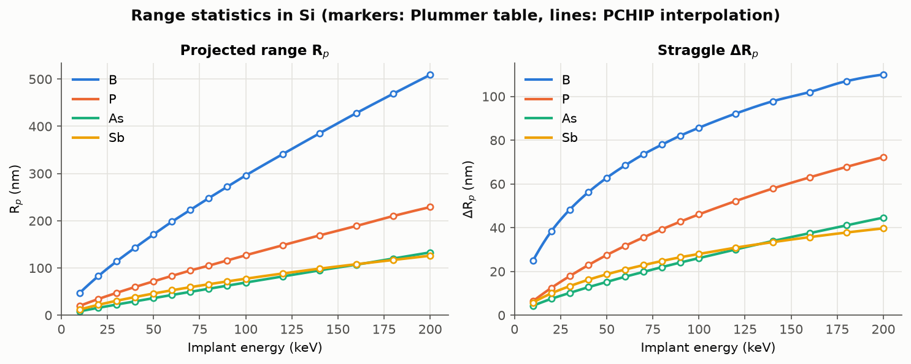
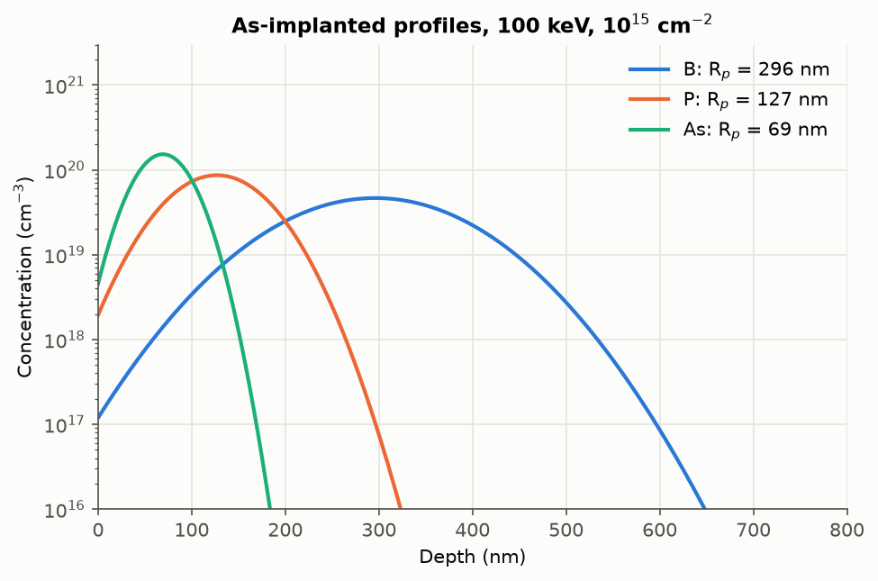
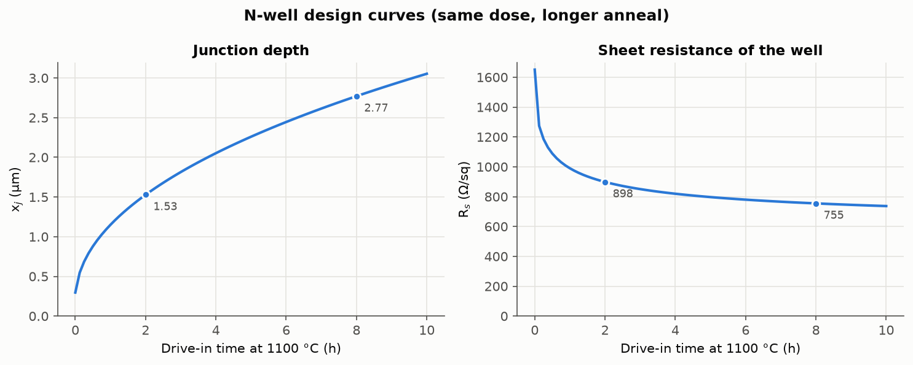
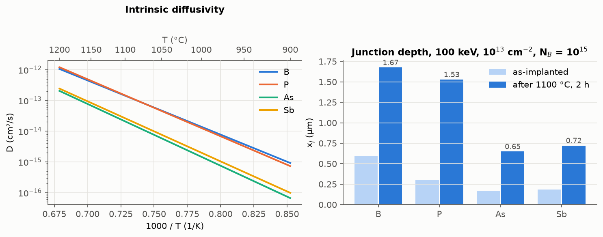
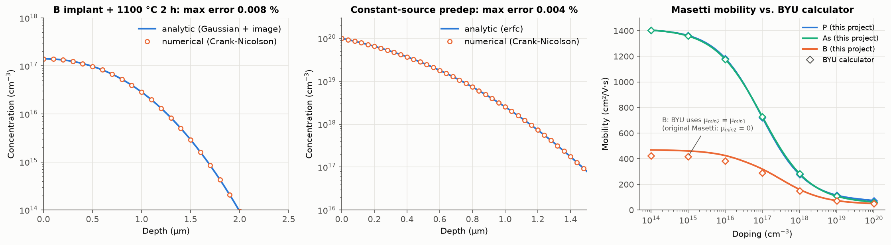

# 02. 이온주입 및 확산 (Ion Implantation, Drive-in) 시뮬레이션

## 1. 목적

ISRC 반도체 기본공정교육에서는 이온주입기(ion implanter)와 확산로(diffusion furnace) 공정을 진행하고, 4-point probe로 면저항을 측정했습니다. 이 모듈에서는 도펀트가 들어가고(주입), 퍼지고(열처리), 전기적 특성(면저항)으로 나타나기까지의 흐름을 하나로 이어서 계산합니다.

1. 도펀트 종류, 에너지, dose에 따른 주입 직후 농도 분포를 계산합니다.
2. 열처리 온도와 시간에 따라 분포가 어떻게 퍼지고 접합 깊이(xj)가 어떻게 변하는지 계산합니다.
3. 최종 분포의 면저항을 계산해 공정 조건과 측정값(4-point probe)을 연결합니다.

01 산화 모듈과 같이 교과서 값을 기준으로 계산하고, 독립적인 방법(해석해와 수치해, 공개 계산기, 교재 예제)과 비교해 검증했습니다.

## 2. 모델

### 2.1 이온주입 분포

주입된 이온은 무작위 충돌을 거쳐 멈추므로 깊이 분포를 Gaussian으로 근사합니다.

$$C(x) = \frac{Q}{\sqrt{2\pi}\,\Delta R_p} \exp\left[-\frac{(x - R_p)^2}{2\Delta R_p^2}\right], \qquad C_p = \frac{Q}{\sqrt{2\pi}\,\Delta R_p} \approx \frac{0.4\,Q}{\Delta R_p}$$

투영 비정 Rp와 표준편차 ΔRp는 Plummer 교재의 표(B, P, As, Sb, 10~200 keV, 비정렬 Si)를 사용하고, 표 사이 값은 단조 보간(PCHIP)으로 구합니다. 표 범위 밖은 외삽하지 않습니다.

### 2.2 확산

일정한 확산계수 D에 대한 Fick 제2법칙을 풉니다. D는 Plummer 교재의 진성(intrinsic) 확산계수 $D = D_0 \exp(-E_a/kT)$를 사용합니다.

| 도펀트 | D₀ [cm²/s] | Eₐ [eV] | D at 1100 °C [cm²/s] |
|---|---|---|---|
| B | 1.0 | 3.5 | 1.43 × 10⁻¹³ |
| P | 4.70 | 3.68 | 1.46 × 10⁻¹³ |
| As | 9.17 | 3.99 | 2.08 × 10⁻¹⁴ |
| Sb | 4.58 | 3.88 | 2.63 × 10⁻¹⁴ |

열처리 효과는 D와 t의 곱인 Dt(thermal budget)로 정리되고, 여러 단계의 열처리는 $Dt_{eff} = \sum D_i t_i$로 더합니다. 주입 Gaussian을 열처리하면 분산이 $\Delta R_p^2 + 2Dt$로 넓어집니다(Plummer Ch. 8). 표면에서 도펀트가 빠져나가지 않는 조건(반사 경계)은 x = −Rp에 영상(image) 분포를 더해 맞춥니다.

$$C(x, t) = \frac{Q}{\sqrt{2\pi(\Delta R_p^2 + 2Dt)}}\left[e^{-\frac{(x - R_p)^2}{2(\Delta R_p^2 + 2Dt)}} + e^{-\frac{(x + R_p)^2}{2(\Delta R_p^2 + 2Dt)}}\right]$$

해석해와 별도로 Crank-Nicolson 유한차분 해법을 구현했습니다. 해석해를 검증하는 기준이면서, 이후 Process Integration 모듈에서 해석해가 없는 임의의 초기 분포를 다루는 데 사용합니다.

### 2.3 전기적 특성

이동도는 Masetti 모델(300 K)을 사용합니다. 접합 위 도핑층의 면저항은 순 캐리어 농도(C − N_B)와 이동도를 깊이 방향으로 적분해 구합니다.

$$R_s = \frac{1}{q \int_0^{x_j} \left[C(x) - N_B\right] \mu\left(C(x) + N_B\right) dx}$$

이동도는 전체 불순물 농도(C + N_B)로 계산하고, 도펀트는 모두 활성화되었다고 가정합니다.

## 3. 결과

### 3.1 투영 비정과 표준편차



- 같은 에너지에서는 가벼운 이온일수록 깊이 들어갑니다. 100 keV에서 Rp는 B 296 nm, P 127 nm, As 69 nm입니다.
- B는 ΔRp 자체가 가장 커서(100 keV에서 86 nm) 분포가 깊이 방향으로 넓게 퍼집니다.
- As와 Sb는 B, P보다 훨씬 무거워 같은 에너지에서 Rp가 B의 1/4 수준이고, 두 도펀트의 Rp는 서로 비슷합니다. 얕은 n+ 접합에 무거운 도펀트를 쓰는 이유입니다.

### 3.2 주입 직후 분포



| 100 keV, 10¹⁵ cm⁻² | Rp | ΔRp | 최대 농도 | 표면 위로 넘어가는 비율 |
|---|---|---|---|---|
| B | 296 nm | 85.7 nm | 4.66 × 10¹⁹ cm⁻³ | 0.03 % |
| P | 127 nm | 46.1 nm | 8.65 × 10¹⁹ cm⁻³ | 0.29 % |
| As | 69 nm | 26.1 nm | 1.53 × 10²⁰ cm⁻³ | 0.40 % |

Gaussian은 수학적으로 표면(x = 0) 위까지 꼬리가 이어지므로 그만큼의 dose는 Si 안에 존재하지 않습니다. Rp/ΔRp가 작은 얕은 주입일수록 이 비율이 커지며, 이 모듈에서는 이 비율을 따로 계산해 근사가 유효한지 확인합니다.

### 3.3 N-well drive-in 설계

시나리오는 p형 기판(B 10¹⁵ cm⁻³)에 P를 100 keV, 10¹³ cm⁻²로 주입하고 1100 °C에서 drive-in 하는 n-well 형성입니다.




| Drive-in 시간 | Dt [cm²] | 확산 길이 2√(Dt) | 최대 농도 | xj | Rs |
|---|---|---|---|---|---|
| 0 h | 0 | 0 µm | 8.65 × 10¹⁷ cm⁻³ | 0.30 µm | 1651 Ω/sq |
| 0.5 h | 2.64 × 10⁻¹⁰ | 0.33 µm | 2.94 × 10¹⁷ cm⁻³ | 0.88 µm | 1089 Ω/sq |
| 1 h | 5.27 × 10⁻¹⁰ | 0.46 µm | 2.26 × 10¹⁷ cm⁻³ | 1.15 µm | 990 Ω/sq |
| 2 h | 1.05 × 10⁻⁹ | 0.65 µm | 1.66 × 10¹⁷ cm⁻³ | 1.53 µm | 898 Ω/sq |
| 4 h | 2.11 × 10⁻⁹ | 0.92 µm | 1.20 × 10¹⁷ cm⁻³ | 2.05 µm | 819 Ω/sq |
| 8 h | 4.22 × 10⁻⁹ | 1.30 µm | 8.59 × 10¹⁶ cm⁻³ | 2.77 µm | 755 Ω/sq |

- 접합 깊이는 시간에 비례하지 않고 대략 √t에 따라 늘어납니다. 2 h에서 8 h로 시간을 4배 늘려도 xj는 1.53 µm에서 2.77 µm로 약 1.8배 늘어납니다. 깊은 well이 필요할수록 열처리 시간이 급격히 늘어나는 이유입니다.
- **같은 dose인데도 열처리가 길어질수록 면저항이 낮아집니다.** 도펀트 총량은 같지만 분포가 퍼지면서 최대 농도가 낮아지고, 저농도에서는 이온화 불순물 산란이 줄어 이동도가 높아지기 때문입니다. 실습에서 4-point probe로 면저항을 측정하는 이유가 여기에 있습니다. 면저항은 dose뿐 아니라 열처리 이력까지 반영합니다.

### 3.4 도펀트 비교



같은 조건(100 keV, 10¹³ cm⁻², 1100 °C 2 h)에서 B와 P는 접합이 1.5 µm 이상으로 깊어지지만, As와 Sb는 0.7 µm 안팎에 머뭅니다.

- B와 P는 1100 °C 부근에서 확산계수가 거의 같습니다. 그래서 twin-well 공정에서 n-well(P)과 p-well(B)을 같은 열처리로 비슷한 깊이까지 만들 수 있습니다.
- As는 확산계수가 B와 P의 약 1/7이고 Rp도 작습니다. 열처리를 거쳐도 접합이 얕게 유지되므로 NMOS 소스/드레인처럼 얕은 n+ 접합에 사용합니다.

### 3.5 Plummer 교재 예제 다시 계산하기

Plummer 교재 7장에는 B p-well을 설계하는 예제가 있습니다. 목표는 xj = 3 µm, Rs = 900 Ω/sq이고 기판 농도는 10¹⁵ cm⁻³입니다. 교재는 Irvin 곡선(그래프)에서 표면 농도 Cs ≈ 4 × 10¹⁷ cm⁻³을 읽고, Dt와 1100 °C drive-in 시간을 계산합니다.

| 경우 | Cs [cm⁻³] | D [cm²/s] | Dt [cm²] | Drive-in 시간 | Masetti로 계산한 Rs |
|---|---|---|---|---|---|
| 교재 (Irvin 곡선) | 4 × 10¹⁷ | 1.5 × 10⁻¹³ | 3.76 × 10⁻⁹ | 6.95 h | 567 Ω/sq |
| 이 프로젝트, 교재 Cs 사용 | 4 × 10¹⁷ | 1.43 × 10⁻¹³ | 3.76 × 10⁻⁹ | 7.31 h | 567 Ω/sq |
| 이 프로젝트, Rs = 900 Ω/sq가 되는 Cs | 2.03 × 10¹⁷ | 1.43 × 10⁻¹³ | 4.24 × 10⁻⁹ | 8.25 h | 900 Ω/sq |

(교재는 Dt를 3.7 × 10⁻⁹ cm²로 반올림해 6.8 h를 얻었습니다.)

- 확산계수는 교재 값(1.5 × 10⁻¹³)과 5 % 이내로 일치합니다.
- Masetti 이동도로 면저항을 직접 적분하면, 900 Ω/sq에 해당하는 표면 농도는 2.0 × 10¹⁷ cm⁻³으로 교재가 그래프에서 읽은 값의 절반입니다. 그래프 판독 오차와 Irvin 곡선이 만들어진 1960년대 이동도 데이터와 Masetti 모델의 차이가 원인으로 보입니다.
- 그런데도 drive-in 시간 차이는 13 %(7.3 h와 8.3 h)에 그칩니다. Dt가 Cs에 로그로만 의존하기 때문입니다($Dt = x_j^2 / 4\ln(C_s/N_B)$). **표면 농도를 두 배 잘못 잡아도 공정 시간 오차는 크지 않지만, 면저항은 1.6배 달라집니다.** 접합 깊이와 면저항 중 어느 쪽을 목표로 공정을 관리하느냐에 따라 필요한 정확도가 다릅니다.

## 4. 검증



| 항목 | 비교 대상 | 결과 |
|---|---|---|
| 주입 Gaussian 열처리 (B, 1100 °C 2 h) | 해석해 vs Crank-Nicolson 수치해 | 최대 오차 0.008 %, dose 보존 |
| 일정 표면 농도 predeposition | erfc 해석해 vs 수치해 | 최대 오차 0.004 %, dose 오차 0.0001 % |
| 이동도 (P, As, 10¹⁴~10²⁰ cm⁻³) | BYU Cleanroom 계산기 | 14개 조건 모두 일치 (차이 0.000 %) |
| 이동도 (B) | BYU Cleanroom 계산기 | 저농도에서 10.6 % 차이 (아래 설명) |
| B 확산계수 (1100 °C) | Plummer 교재 예제 | 5 % 이내 |
| 접합 깊이 계산 | 닫힌 식 $x_j = \sqrt{4Dt\ln(C_s/N_B)}$ | 0.01 % 이내 |

**BYU 계산기와 B 이동도가 다른 이유**: Masetti 원 논문에서 정공(B)은 μ_min2 = 0입니다. BYU 계산기는 코드에서 세 도펀트 모두 μ_min2 = μ_min1로 계산합니다. 전자(P, As)는 원래 두 값이 같으므로 결과가 같지만, B는 저농도 이동도가 μ_max = 470.5가 아니라 425.6 cm²/Vs로 계산됩니다. 저농도 극한에서 이동도가 μ_max에 수렴해야 한다는 모델 정의로도 원 논문 값이 맞다는 것을 확인할 수 있으며, 이 조건을 테스트에 넣었습니다.

자동 테스트는 이 모듈에서 35개, 전체 65개입니다.

## 5. 한계와 다음 단계

- **Gaussian 근사**: 실제 B 분포는 표면 쪽으로 치우친 비대칭 형태이고, 결정 방향으로 깊이 들어가는 채널링 꼬리도 있습니다. 정확한 분포에는 Pearson IV 같은 4-moment 분포나 Monte Carlo(SRIM)가 필요합니다.
- **진성 확산만 반영**: 도핑 농도가 진성 캐리어 농도보다 높은 소스/드레인 영역에서는 농도 의존 확산, 전기장 효과가 나타납니다. 주입 손상으로 인한 일시적 확산 증가(TED)와 산화로 인한 확산 증가(OED)도 포함하지 않았습니다. 따라서 이 모듈의 정량 결과는 well처럼 농도가 낮은 영역에 적용합니다.
- **Si 단일 층**: 스크린 산화막이나 마스크(PR, SiO₂)를 통과하는 주입은 다루지 않습니다.
- **완전 활성화 가정**: 모든 도펀트가 전기적으로 활성화되었다고 봅니다.
- **01 산화 모듈과의 연결**: 고농도 도핑에 따른 산화 속도 증가와 산화 중 도펀트 재분포(segregation)는 Process Integration 모듈에서 함께 다룰 예정입니다.

## 6. 재현 방법

```bash
.venv/bin/python -m pytest
.venv/bin/python scripts/run_implant_diffusion.py
```

## 참고 문헌

1. J. D. Plummer, M. D. Deal, and P. B. Griffin, *Silicon VLSI Technology: Fundamentals, Practice and Modeling*, Prentice Hall (2000), Ch. 7 (Diffusion), Ch. 8 (Ion Implantation). 강의 슬라이드: [Ch. 7](http://apachepersonal.miun.se/~gorthu/Plummer/Material/Plummer/0130407836_ppt07.pdf), [Ch. 8](http://apachepersonal.miun.se/~gorthu/Plummer/Material/Plummer/0130407836_ppt08.pdf).
2. G. Masetti, M. Severi, and S. Solmi, "Modeling of Carrier Mobility Against Carrier Concentration in Arsenic-, Phosphorus-, and Boron-Doped Silicon," *IEEE Trans. Electron Devices* ED-30, 764 (1983).
3. J. C. Irvin, "Resistivity of Bulk Silicon and of Diffused Layers in Silicon," *Bell Syst. Tech. J.* 41, 387 (1962).
4. Brigham Young University Cleanroom, [Resistivity & Mobility Calculator](https://cleanroom.byu.edu/ResistivityCal) (2026-10-11 조회).
