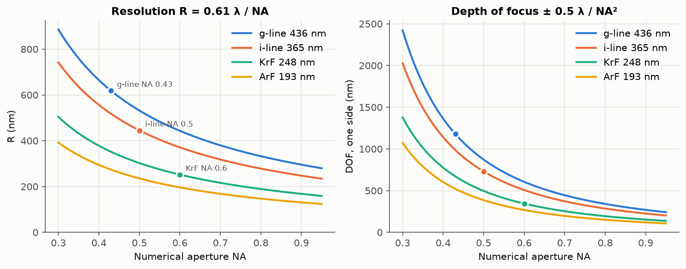
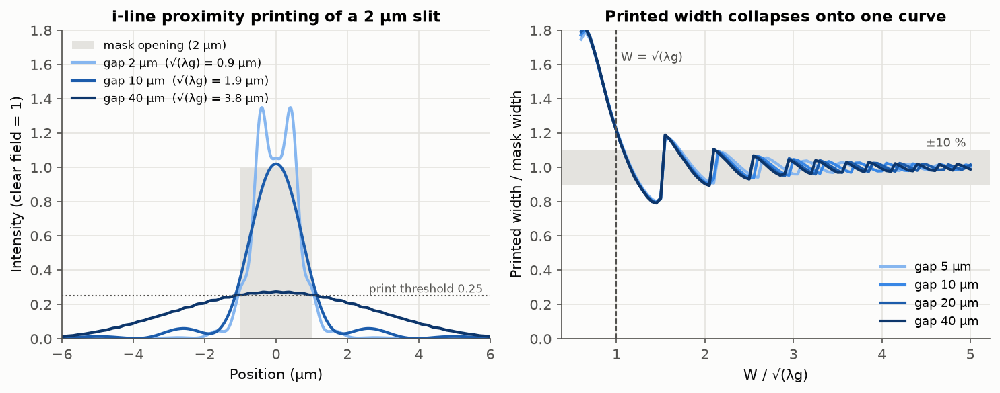
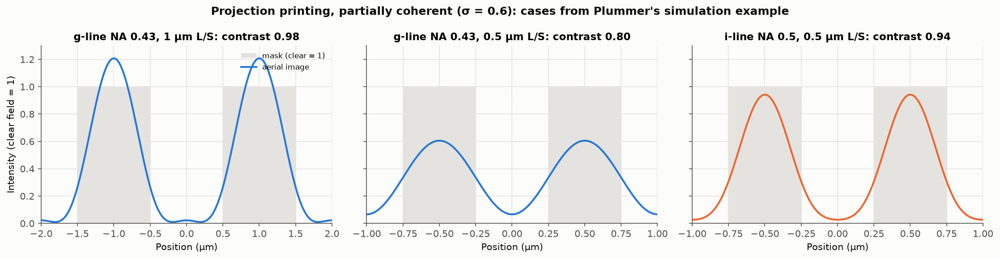
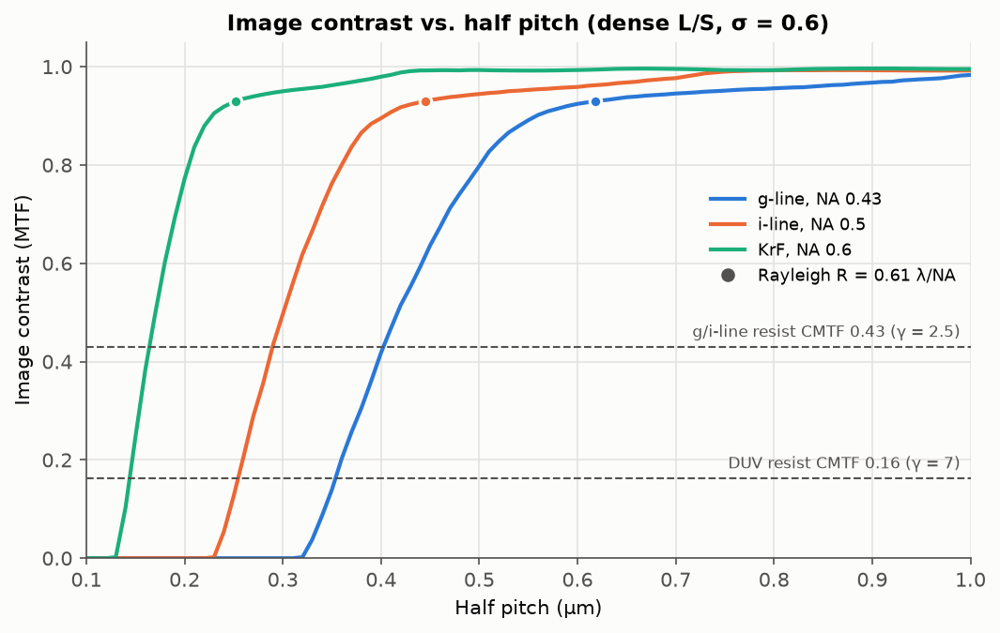
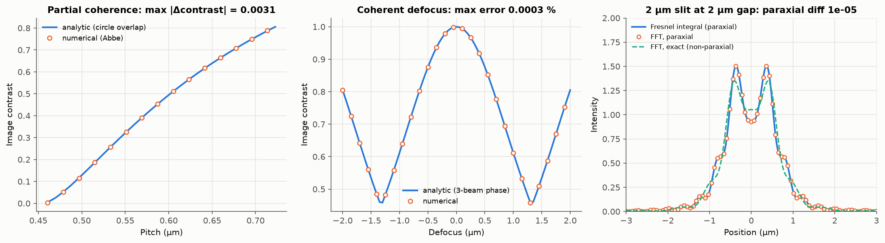

# 03. 포토리소그래피 (Photolithography) 시뮬레이션

## 1. 목적

ISRC 반도체 기본공정교육에서는 감광막(PR) 도포, 노광, 현상을 진행하고 OM과 SEM으로 패턴을 관찰한 뒤 PR을 제거했습니다. 이 모듈에서는 마스크 패턴이 빛을 통해 웨이퍼 위의 PR 패턴으로 옮겨지는 과정을 계산합니다.

1. 노광 장비의 파장과 NA가 해상도와 초점 심도(DOF)를 어떻게 결정하는지 정리합니다.
2. 마스크와 웨이퍼 사이에 간격이 있는 근접(proximity) 노광에서 회절 때문에 패턴이 어떻게 변하는지 계산합니다.
3. 양산에서 쓰는 축소 투영(projection) 노광의 공간상(aerial image)을 계산하고, PR의 contrast와 비교해 실제로 형성 가능한 최소 패턴을 구합니다.
4. 초점과 노광량이 함께 변할 때 CD가 규격 안에 드는 공정 창(process window)을 구합니다.

## 2. 모델

### 2.1 Rayleigh 해상도와 초점 심도

$$R = k_1 \frac{\lambda}{NA}, \qquad DOF = \pm k_2 \frac{\lambda}{NA^2}$$

Rayleigh 기준에서는 k₁ = 0.61이고, k₁과 k₂는 실제 공정에서 실험으로 정하는 계수입니다(Plummer Ch. 5). 해상도를 높이려고 NA를 키우면 DOF는 NA²에 반비례해 더 빠르게 줄어듭니다.

### 2.2 근접 노광: Fresnel 회절

마스크와 PR 사이의 간격 g에서는 근거리장(Fresnel) 회절이 일어납니다. 교재는 최소 선폭을 $W_{min} \approx \sqrt{\lambda g}$로 근사합니다. 이 모듈에서는 폭 W인 슬릿을 통과한 빛의 세기를 두 가지 방법으로 계산합니다.

- **Fresnel 적분(해석해)**: 근축(paraxial) 근사를 사용한 닫힌 식입니다.
- **각스펙트럼 전파(수치해)**: 마스크 직후의 장을 FFT로 공간 주파수 성분으로 나누고, 각 성분을 정확한 전달함수 $e^{i 2\pi g \sqrt{1/\lambda^2 - f^2}}$로 전파합니다. 근축 근사를 쓰지 않습니다.

PR에 패턴이 형성되는 기준은 세기 0.25(넓은 개구의 기하학적 가장자리에서의 세기)로 두었습니다. 넓은 패턴이 마스크 크기 그대로 인쇄되도록 노광량을 맞춘 것과 같습니다.

### 2.3 축소 투영 노광: 부분 결맞음 결상

마스크의 회절광 중 렌즈의 동공(NA) 안으로 들어온 성분만 웨이퍼에 상을 만듭니다(Plummer Ch. 5, Eq. 19~21). 실제 조명은 한 점이 아니라 크기가 있는 광원이므로(부분 결맞음, σ = NA_condenser / NA_projection), 광원의 각 점에서 만든 상의 세기를 평균합니다(Abbe 방법).

- 마스크: 선(불투명)과 간격(투명)이 같은 폭으로 반복되는 binary line/space
- 조명: 원형, σ = 0.6 (교재의 일반적인 범위 0.5~0.7)
- 초점 이탈: 동공 위상 $\phi = \frac{2\pi z}{\lambda}\left(\sqrt{1 - NA^2\rho^2} - 1\right)$

### 2.4 레지스트

레지스트의 contrast γ와 임계 MTF(CMTF)는 다음과 같이 정의합니다(Plummer Ch. 5).

$$\gamma = \frac{1}{\log_{10}(D_f/D_0)}, \qquad CMTF = \frac{10^{1/\gamma} - 1}{10^{1/\gamma} + 1}$$

공간상의 contrast가 CMTF보다 커야 패턴이 형성됩니다. 교재의 일반적인 값으로 g/i-line 레지스트는 γ = 2.5(CMTF 0.43), DUV 레지스트는 γ = 7(CMTF 0.16)을 사용했습니다. CD는 노광량 × 공간상 세기가 문턱값보다 작은 영역(양성 레지스트에서 남는 선)의 폭으로 계산합니다.

## 3. 결과

### 3.1 노광 장비별 해상도와 DOF



| 장비 (교재 예시) | 파장 | NA | R (k₁ = 0.61) | DOF (k₂ = 0.5) |
|---|---|---|---|---|
| g-line | 436 nm | 0.43 | 619 nm | ±1.18 µm |
| i-line | 365 nm | 0.50 | 445 nm | ±0.73 µm |
| KrF | 248 nm | 0.60 | 252 nm | ±0.34 µm |

g-line에서 KrF로 가며 해상도는 2.5배 좋아지지만 DOF는 3.4배 줄어듭니다. 미세 패턴일수록 웨이퍼 평탄도와 초점 제어가 중요해지는 이유이며, CMP로 표면을 평탄화하는 공정이 필요해진 배경이기도 합니다.

### 3.2 근접 노광



- 왼쪽 그래프는 2 µm 슬릿을 i-line으로 노광할 때의 세기입니다. 간격이 2 µm이면 패턴 폭은 유지되지만 슬릿 안쪽에서 세기가 크게 출렁이고(Fresnel 줄무늬), 40 µm이면 빛이 넓게 퍼져 최대 세기가 인쇄 기준(0.25) 근처까지 떨어집니다.
- 오른쪽 그래프는 인쇄된 폭을 마스크 폭으로 나눈 값입니다. 가로축을 $W/\sqrt{\lambda g}$로 잡으면 **간격이 5~40 µm로 달라도 결과가 한 곡선 위에 놓입니다.** Fresnel 회절의 크기가 Fresnel 수 $N_F = W^2/\lambda g$ 하나로 정해지기 때문입니다.

| W / √(λg) | 1.0 | 1.5 | 2.0 | 3.0 |
|---|---|---|---|---|
| 인쇄 폭 / 마스크 폭 (간격 10 µm) | 1.22 | 0.82 | 0.91 | 1.05 |

교재의 $W_{min} \approx \sqrt{\lambda g}$는 "패턴이 형성되기 시작하는" 크기입니다. 이 크기에서는 인쇄 폭이 마스크보다 22 % 크게 나옵니다. **CD를 ±10 % 안으로 관리하려면 패턴이 약 2.1√(λg) 이상, ±5 % 안으로 관리하려면 약 3√(λg) 이상이어야 합니다.** 교재 예제(i-line, g = 10 µm, W_min ≈ 2 µm)에 적용하면 CD 관리가 가능한 최소 패턴은 약 4 µm입니다. 곡선이 계단처럼 끊어지는 부분은 Fresnel 줄무늬의 골과 마루가 인쇄 기준을 넘나들며 인쇄 경계가 갑자기 이동하는 지점입니다.

### 3.3 축소 투영 노광의 공간상



교재의 ATHENA 시뮬레이션 예(g-line NA 0.43에서 1 µm와 0.5 µm, i-line NA 0.5에서 0.5 µm)를 같은 조건으로 계산했습니다.

| 조건 | k₁ | 공간상 contrast |
|---|---|---|
| g-line, NA 0.43, 1 µm L/S | 0.99 | 0.98 |
| g-line, NA 0.43, 0.5 µm L/S | 0.49 | 0.80 |
| i-line, NA 0.5, 0.5 µm L/S | 0.69 | 0.94 |

교재가 그림으로 보인 결과(0.5 µm에서 상이 나빠지고, i-line과 큰 NA로 바꾸면 개선됨)를 수치로 확인했습니다. g-line 0.5 µm는 contrast뿐 아니라 최대 세기도 0.6으로 낮아 같은 CD를 얻으려면 노광량을 더 높여야 합니다.

### 3.4 해상 한계: Rayleigh 식과 레지스트 기준



| 장비 | Rayleigh R | 레지스트 기준 최소 half pitch (g/i-line, CMTF 0.43) | 그때의 k₁ | DUV 레지스트 (CMTF 0.16) | 1차 회절 차단 |
|---|---|---|---|---|---|
| g-line, NA 0.43 | 0.62 µm | 0.41 µm | 0.40 | 0.36 µm | 0.32 µm |
| i-line, NA 0.5 | 0.45 µm | 0.29 µm | 0.40 | 0.26 µm | 0.23 µm |
| KrF, NA 0.6 | 0.25 µm | 0.17 µm | 0.41 | 0.15 µm | 0.13 µm |

- 반복 패턴(line/space)은 Rayleigh 해상도(점 두 개를 구분하는 기준)보다 작게도 형성됩니다.
- **세 장비 모두 레지스트 기준 최소 패턴이 k₁ ≈ 0.40에서 나옵니다.** 파장과 NA가 달라도 k₁이 같다는 것은, k₁이 장비가 아니라 조명 조건(σ)과 레지스트 성능으로 정해지는 "공정 계수"라는 뜻입니다. contrast가 높은 DUV 레지스트를 쓰면 같은 장비에서 k₁ ≈ 0.36까지 내려갑니다.
- 어떤 레지스트를 써도 1차 회절광이 동공에 들어오지 못하는 피치 $\lambda / NA(1+\sigma)$, 즉 k₁ = 0.31 아래로는 상이 생기지 않습니다. 이 한계를 넘으려면 조명(off-axis illumination)이나 마스크(위상 반전 마스크)를 바꿔야 합니다.

### 3.5 공정 창 (i-line, NA 0.5, 0.5 µm L/S)


- 왼쪽 Bossung 곡선은 노광량별로 초점에 따른 CD 변화입니다. 초점이 벗어날수록 상이 흐려져 선이 가늘어지고, 노광량이 클수록 CD가 작아집니다.
- 오른쪽은 CD가 500 nm ± 10 % 안에 드는 초점과 노광량 영역입니다. 최적 초점에서의 노광 여유도(exposure latitude)는 46 %이고, **노광 여유도 10 %를 확보할 때 DOF는 ±1.40 µm**입니다.
- 이 값은 Rayleigh 식의 ±0.73 µm보다 넓습니다. 이 계산은 수차가 없는 렌즈, 두께가 없는 레지스트, 정확한 문턱값 레지스트를 가정한 이상적인 값이기 때문입니다. 실제 공정에서는 레지스트 두께(수백 nm에서 1 µm 수준), 웨이퍼 평탄도, 렌즈 수차, 초점 제어 오차가 DOF를 함께 소모합니다. 교재가 k₂를 실험으로 정하는 값이라고 한 것도 이 요인들이 모두 포함되기 때문입니다. **이상적인 광학 계산은 공정 창의 상한을 알려주고, 실제 DOF는 여기서 각 오차 요인을 뺀 값**으로 이해할 수 있습니다.

## 4. 검증



| 항목 | 비교 대상 | 결과 |
|---|---|---|
| 부분 결맞음 결상 (Abbe 수치해) | 원 겹침 면적 해석해 (0차, 1차만 참여하는 피치 영역) | contrast 최대 차이 0.003 |
| 결맞음 조명 초점 이탈 | 3광속 위상차 해석해 | 최대 오차 0.0003 % |
| Fresnel 적분 (해석해) | 근축 각스펙트럼 수치 전파 | 세기 최대 차이 1.3 × 10⁻⁵ |
| 차단 피치 λ/NA(1+σ) | 차단 피치 바로 아래 패턴 | contrast < 10⁻⁹ (상이 생기지 않음) |
| 교재 예제 (KrF R, DOF / 근접 노광 W_min) | Plummer Ch. 5 | 5 % / 10 % 이내 |
| 레지스트 CMTF | 교재의 일반 범위 (g/i-line 약 0.4, DUV 0.1~0.2) | 범위 안 |

**부분 결맞음 해석해**: 1차 회절광이 +1차와 −1차 중 하나만 동공에 들어오는 피치 영역에서는, 조명 원 중 1차광이 통과하는 비율이 두 원의 겹침 면적으로 정확히 계산됩니다. 이를 이용해 수치 결상 결과를 독립적으로 확인했습니다.

**Fresnel 근사의 오차**: 근축 근사를 쓰지 않은 정확한 전파와 비교하면, 2 µm 슬릿에서 간격 40 µm일 때 세기 차이는 0.004, 10 µm일 때 0.013이지만 간격 2 µm일 때는 0.18까지 커집니다. 간격이 패턴 크기와 비슷한 밀착 노광 영역에서는 Fresnel 적분 공식을 그대로 쓰면 안 되므로, 이 모듈의 근접 노광 결과는 모두 정확한 각스펙트럼 전파로 계산했습니다.

자동 테스트는 이 모듈에서 22개, 전체 87개입니다.

## 5. 한계와 다음 단계

- **1D 패턴**: 무한히 긴 line/space와 슬릿만 다룹니다. 접촉 구멍(contact hole)이나 선 끝(line end) 같은 2D 패턴, 광 근접 보정(OPC)은 포함하지 않았습니다.
- **스칼라 회절, 공기 중 결상**: 편광 효과(고 NA에서 중요), 레지스트 내부의 굴절과 정상파(standing wave), 반사 방지막의 영향은 다루지 않습니다.
- **문턱값 레지스트**: Dill 노광 모델(A, B, C 계수)과 현상 속도 모델은 레지스트별 실측 계수가 필요해 구현하지 않았습니다. 그 대신 교재의 γ, CMTF 범위로 레지스트 성능을 반영했습니다.
- **단색광**: 근접 노광의 수은 램프 광대역 스펙트럼과 조명 각도 분산은 반영하지 않았습니다. 실제 장비에서는 이 효과로 Fresnel 줄무늬가 일부 평균화됩니다.

## 6. 재현 방법

```bash
.venv/bin/python -m pytest
.venv/bin/python scripts/run_lithography.py
```

## 참고 문헌

1. J. D. Plummer, M. D. Deal, and P. B. Griffin, *Silicon VLSI Technology: Fundamentals, Practice and Modeling*, Prentice Hall (2000), Ch. 5 (Lithography). 강의 슬라이드: [Ch. 5](http://apachepersonal.miun.se/~gorthu/Plummer/Material/Plummer/0130407836_ppt05.pdf).
2. J. W. Goodman, *Introduction to Fourier Optics*, 3rd ed., Roberts & Company (2005). (Fresnel 회절, 각스펙트럼 전파, 결맞음 결상)
3. C. A. Mack, *Fundamental Principles of Optical Lithography*, Wiley (2007). (부분 결맞음 결상, 공정 창, Bossung 곡선)
