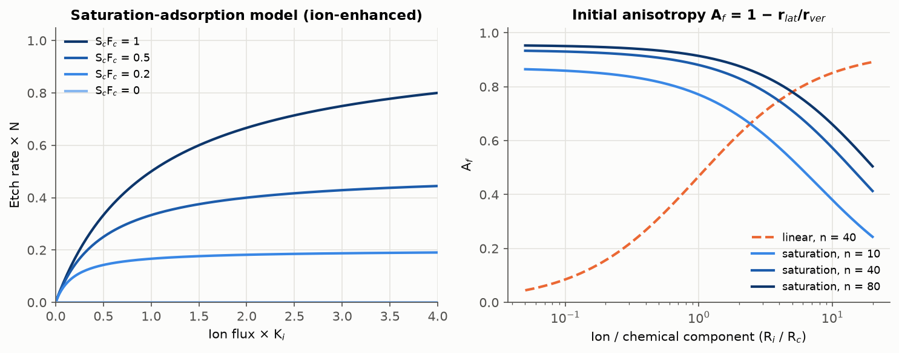
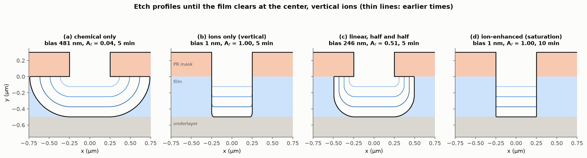
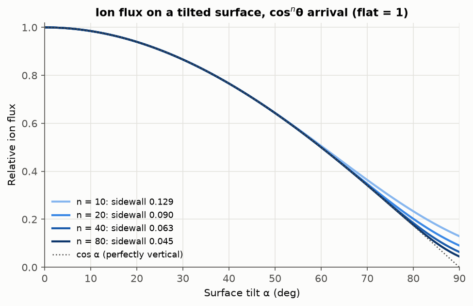
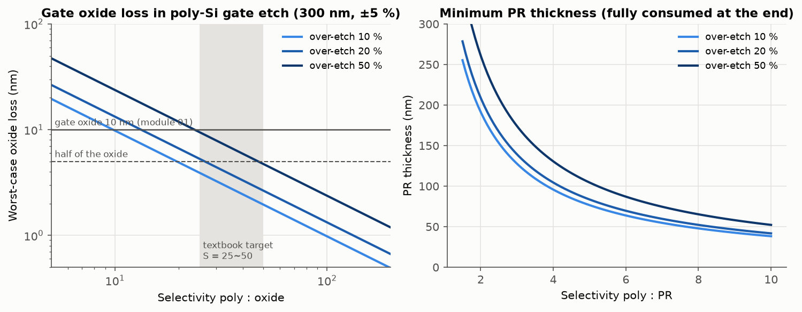
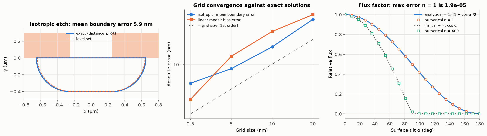

# 04. 건식 식각 (Dry Etching) 시뮬레이션

## 1. 목적

ISRC 반도체 기본공정교육에서는 건식 식각 장비로 막을 식각하고, Spectroscopic Ellipsometer로 식각 전후의 두께를 측정했습니다. 이 모듈에서는 식각 공정에서 가장 중요한 두 지표인 **이방성(directionality)** 과 **선택비(selectivity)** 를 중심으로 다음을 계산합니다.

1. 화학 성분(반응성 중성종)과 물리 성분(이온)이 식각 속도와 단면 형상을 어떻게 결정하는지 계산합니다.
2. 막이 식각되며 단면이 어떻게 변하는지 2D로 시뮬레이션합니다.
3. 웨이퍼 안의 두께와 식각 속도 산포를 고려해 과식각(over-etch) 시간과 필요한 선택비, PR 두께를 정합니다.

## 2. 모델

### 2.1 식각 지표 (Plummer Ch. 10)

$$A_f = 1 - \frac{r_{lat}}{r_{ver}} = 1 - \frac{b}{d}, \qquad S = \frac{r_1}{r_2}$$

A_f는 등방성 식각에서 0, 완전 이방성 식각에서 1입니다. b는 마스크 아래로 파고든 폭(한쪽 bias), d는 식각 깊이입니다.

### 2.2 식각 속도 모델

교재는 플라즈마 식각을 화학 성분과 이온 성분의 결합으로 설명합니다.

| 모델 | 식 | 의미 |
|---|---|---|
| 선형 모델 | $ER = (S_c K_f F_c + K_i F_i)/N$ | 두 성분이 독립적으로 더해집니다. |
| 포화 흡착 모델 | $ER = \frac{1}{N}\left(\frac{1}{K_i F_i} + \frac{1}{S_c F_c}\right)^{-1}$ | 두 과정이 직렬로 일어나 느린 쪽이 속도를 정합니다. 어느 한쪽이라도 없으면 식각되지 않습니다(이온 보조 식각). |

입자의 입사 방향은 교재를 따랐습니다.

- **반응성 중성종**: 부착 확률이 낮아(S_c ≈ 0.01) 표면에서 여러 번 튕기므로, 모든 방향의 면에 고르게 도달한다고 둡니다.
- **이온**: 플라즈마 sheath 전계로 가속되어 거의 연직으로 입사합니다. 입사각 분포는 cosⁿθ(n = 10~80)입니다. 기울어진 면이 받는 이온 플럭스는 이 분포를 입체각으로 적분해 계산합니다.

### 2.3 2D 단면 형상 진화: level set 방법

식각 표면을 함수 φ(x, y)의 0 등고선으로 나타내고, 표면이 법선 방향으로 속도 V(n)만큼 움직이는 방정식을 풉니다.

$$\frac{\partial \phi}{\partial t} + V(\mathbf{n})\,|\nabla \phi| = 0$$

V가 표면 방향 n에 따라 달라지므로(이온은 위에서만 오므로 바닥은 빠르고 측벽은 느림), 이런 경우에도 안정적인 국소 Lax-Friedrichs 차분을 사용했습니다. 몇 단계마다 φ를 fast marching으로 부호 거리 함수로 되돌리고, PR 마스크와 하부막은 재료별 선택비만큼 속도를 줄여 반영합니다.

## 3. 결과

### 3.1 식각 속도 모델과 이방성



- 왼쪽은 교재의 포화 흡착 모델 그림을 다시 계산한 것입니다. 이온 플럭스를 늘리면 처음에는 식각 속도가 비례해 늘다가, 화학 성분(S_cF_c)이 부족해지면 그 값에서 포화합니다.
- 오른쪽은 평평한 면에서의 초기 식각 속도로 계산한 이방성입니다. 이온 입사각 분포 때문에 측벽(90°)도 이온을 일부 받습니다(n = 40에서 바닥의 6.3 %).

| R_i / R_c | 선형 모델 (n = 40) | 포화 모델 (n = 40) | 포화 모델 (n = 80) |
|---|---|---|---|
| 0.25 | 0.19 | 0.92 | 0.95 |
| 1 | 0.47 | 0.88 | 0.91 |
| 4 | 0.75 | 0.75 | 0.81 |

**두 모델은 이방성을 얻는 방법이 반대입니다.** 선형 모델에서는 화학 성분이 측벽도 똑같이 깎으므로 이온 비중을 높여야 이방성이 좋아집니다. 이온 비중을 높이면 물리적 스퍼터링 성분이 커져 선택비가 떨어집니다. 반면 이온 보조(포화) 모델에서는 이온이 없는 측벽이 식각되지 않으므로, **화학 성분이 충분하고 이온이 속도를 제한하는 조건에서 이방성이 가장 좋습니다**(A_f → 1 − 측벽 이온 비율). 이온을 과도하게 늘리면 바닥은 화학 성분에서 포화되고 측벽만 계속 빨라져 오히려 이방성이 떨어집니다. 이온 밀도와 이온 에너지를 따로 조절할 수 있는 고밀도 플라즈마(ICP, ECR) 장비가 널리 쓰이는 이유와 연결됩니다.

### 3.2 단면 형상



교재의 SPEEDIE 시뮬레이션 예(화학만, 이온만, 반반)와 이온 보조 식각을 같은 구조(개구 0.5 µm, 막 0.5 µm, PR 마스크)에서 계산했습니다. 모든 경우 막 중앙이 뚫리는 시점까지 진행했고, bias는 막 윗면 0.1 µm 아래에서 쟀습니다.

| 경우 | R_c | R_i | 소요 시간 | bias | A_f | 정확해 |
|---|---|---|---|---|---|---|
| (a) 화학 성분만 | 0.1 | 0 | 5 min | 481 nm | 0.04 | 490 nm, 0 |
| (b) 이온만 | 0 | 0.1 | 5 min | 1 nm | 1.00 | 0 nm, 1 |
| (c) 선형, 반반 | 0.05 | 0.05 | 5 min | 246 nm | 0.51 | 250 nm, 0.5 |
| (d) 이온 보조 (포화) | 0.1 | 0.1 | 10 min | 1 nm | 1.00 | 0 nm, 1 |

(속도 단위는 µm/min)

- (a) 화학 식각은 등방성이라 마스크 아래로 식각 깊이만큼 파고듭니다. 습식 식각과 같은 형태입니다.
- (c) 선형 모델에서 성분을 반반 섞으면 측벽이 둥글게 파이고 A_f는 0.5입니다.
- (d) 이온 보조 식각은 같은 화학 성분과 이온 성분을 쓰고도 측벽이 수직으로 유지됩니다. 다만 두 과정이 직렬이므로 식각 속도는 절반(0.05 µm/min)이 됩니다.

### 3.3 이온 입사각 분포



| n | 45° 면 | 80° 면 | 측벽 (90°) |
|---|---|---|---|
| 10 | 0.708 | 0.233 | 0.129 |
| 40 | 0.707 | 0.184 | 0.064 |
| 80 | 0.707 | 0.176 | 0.045 |

45° 정도의 완만한 면에서는 분포의 폭과 관계없이 cos α에 가깝지만, 수직에 가까운 면에서는 분포의 폭에 따라 플럭스가 크게 달라집니다. 측벽이 받는 이온은 n = 10에서 n = 80으로 가며 약 1/3로 줄어듭니다. sheath 전압을 높이거나 압력을 낮춰 이온 충돌을 줄이면 n이 커지고, 측벽 식각이 줄어듭니다.

### 3.4 과식각과 선택비 설계

시나리오는 01 모듈에서 설계한 **10 nm 게이트 산화막** 위의 poly-Si 게이트(300 nm) 식각입니다. 웨이퍼 안의 poly 두께와 식각 속도가 각각 ±5 % 퍼져 있다고 가정했습니다.



- 가장 두껍고 느리게 식각되는 곳은 가장 얇고 빠른 곳보다 22 % 늦게 뚫립니다. 그동안 먼저 뚫린 곳의 게이트 산화막은 계속 깎입니다.

| 과식각 | 산화막 손실 ≤ 5 nm에 필요한 선택비 | ≤ 2 nm | 선택비 25에서의 손실 | 선택비 50에서의 손실 |
|---|---|---|---|---|
| 10 % | 20 | 49 | 3.9 nm | 2.0 nm |
| 20 % | 27 | 66 | 5.3 nm | 2.7 nm |
| 50 % | 47 | 119 | 9.5 nm | 4.7 nm |

- 과식각 20 %에서 산화막 손실을 절반(5 nm) 이하로 유지하려면 선택비가 약 27 필요합니다. **교재가 제시한 바람직한 선택비 25~50이 이 계산과 같은 범위**입니다.
- 선택비가 10이면 과식각 10 %에서도 9.8 nm가 깎여 산화막이 거의 남지 않고, 20 % 이상이면 10 nm가 모두 뚫립니다. 게이트 산화막이 뚫리면 그 아래 Si 기판까지 식각됩니다.
- PR이 공정 끝까지 남으려면, poly : PR 선택비가 3일 때 최소 139 nm, 5일 때 84 nm가 필요합니다(과식각 20 %, 여유 없음). 실제로는 여유분을 더하고, 03 모듈의 노광 해상도와 DOF를 함께 고려해 PR 두께를 정해야 합니다.

## 4. 검증



| 항목 | 비교 대상 | 결과 |
|---|---|---|
| 등방성 식각 단면 | 정확해: 개구에서 거리 R·t 이내의 영역 | 평균 경계 오차 5.9 nm (격자 2.5 nm) |
| 선형 모델 (연직 이온) 깊이와 bias | 정확해: (개구 × 깊이 R_i·t 직사각형)과 반지름 R_c·t 원의 Minkowski 합 → 깊이 (R_c + R_i)t, bias R_c·t | 깊이 오차 1.3 nm, bias 오차 3.8 nm |
| 포화 모델 (연직 이온) | 측벽에 이온이 없으므로 bias 0, 깊이 = 1/(1/R_i + 1/R_c)·t | 1 nm 이내 |
| 격자 수렴 | 격자 20 → 2.5 nm | 오차가 격자 크기에 비례해 감소(1차 정확도) |
| 이온 플럭스 계수 (n = 1) | 해석해 (1 + cos α)/2 | 최대 오차 1.9 × 10⁻⁵ |
| 이온 플럭스 계수 (n → ∞) | cos α | n = 400에서 0.01 이내 |
| 하부막 선택비 | 막을 뚫은 뒤 1 min 추가 식각, 선택비 10 | 하부막 손실 10 nm (예측과 일치) |

**수치 해법을 바꾼 과정**: 처음에는 등방성 전파에 쓰는 간단한 상류(upwind) 차분을 사용했습니다. 이 방법은 화학 성분과 선형 모델에서는 정확했지만, 포화 모델처럼 속도가 표면 방향에 비선형으로 의존하면 바닥 모서리가 옆으로 번져 측벽이 없어야 할 곳까지 40 nm 넓어졌습니다. 그래서 방향 의존 속도에 쓸 수 있는 국소 Lax-Friedrichs 차분으로 바꾸고, 정확해와의 비교로 다시 검증했습니다.

자동 테스트는 이 모듈에서 20개, 전체 107개입니다.

## 5. 한계와 다음 단계

- **가림(shadowing)과 재방출 미반영**: 좁고 깊은 구조에서 바닥에 도달하는 이온과 중성종이 줄어드는 효과(종횡비 의존 식각, ARDE)와, 측벽에서 튕긴 입자의 재방출은 다루지 않았습니다. 이 모듈의 형상은 종횡비가 1 이하인 구조에 적용합니다.
- **이온 입사각 분포와 포화 모델의 결합**: 이온 입사각이 퍼져 있을 때 포화 모델은 바닥 모서리에서 측벽 쪽으로 퍼지는 동역학이 나타나는데, 이를 정량적으로 검증하려면 가림 효과를 함께 모델링해야 해서 단면 시뮬레이션에서는 연직 이온만 사용했습니다. 입사각 분포의 영향은 3.1과 3.3의 초기 속도 비로만 다뤘습니다.
- **측벽 보호막(inhibitor) 미반영**: 교재가 설명한 폴리머 증착에 의한 경사 측벽은 증착과 식각을 동시에 다뤄야 하므로 05 증착 모듈 이후로 미룹니다.
- **마스크 형상 변화**: PR 침식은 3.4에서 두께로만 계산했고, 단면 시뮬레이션에서는 PR이 식각되지 않는다고 두었습니다.
- **플라즈마 물리**: sheath 전압, 이온 에너지, 라디칼 밀도는 직접 계산하지 않고 R_c, R_i, n으로 요약했습니다.

## 6. 재현 방법

```bash
.venv/bin/python -m pytest
.venv/bin/python scripts/run_etching.py
```

## 참고 문헌

1. J. D. Plummer, M. D. Deal, and P. B. Griffin, *Silicon VLSI Technology: Fundamentals, Practice and Modeling*, Prentice Hall (2000), Ch. 10 (Etching). 강의 슬라이드: [Ch. 10](http://apachepersonal.miun.se/~gorthu/Plummer/Material/Plummer/0130407836_ppt10.pdf).
2. S. Osher and R. Fedkiw, *Level Set Methods and Dynamic Implicit Surfaces*, Springer (2003). (level set 방법, Lax-Friedrichs 차분)
3. J. A. Sethian, *Level Set Methods and Fast Marching Methods*, 2nd ed., Cambridge University Press (1999).
4. J. W. Coburn and H. F. Winters, "Ion- and electron-assisted gas-surface chemistry—An important effect in plasma etching," *J. Appl. Phys.* 50, 3189 (1979). (이온 보조 식각 실험)
