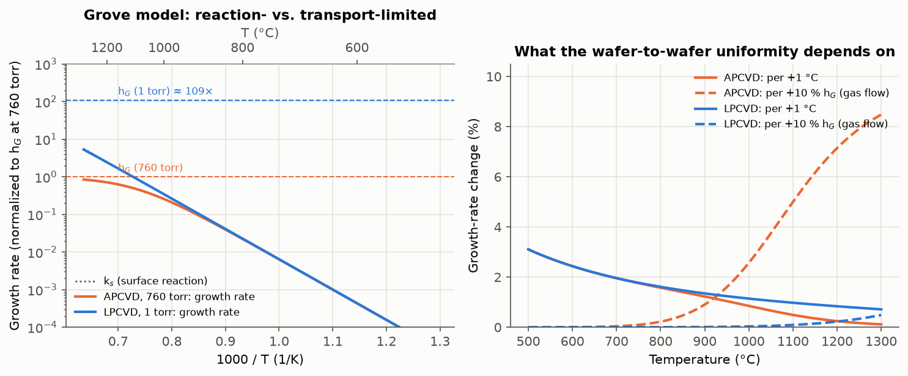
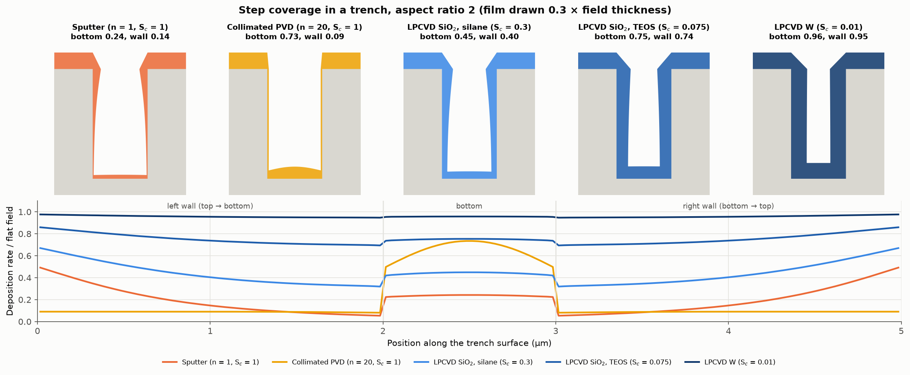
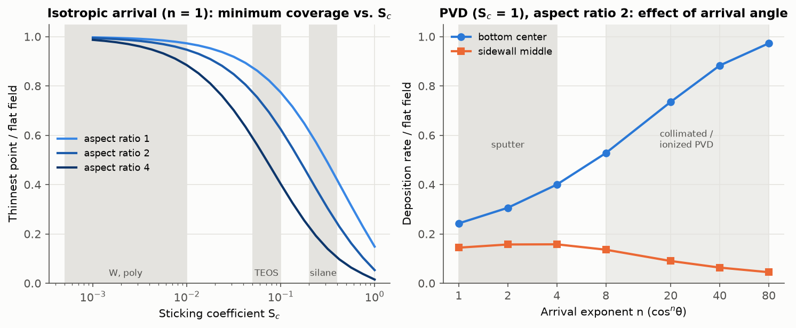
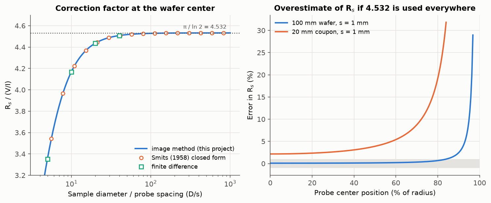
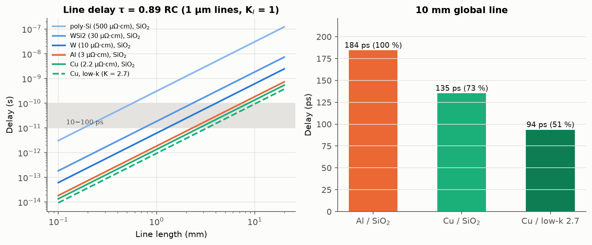
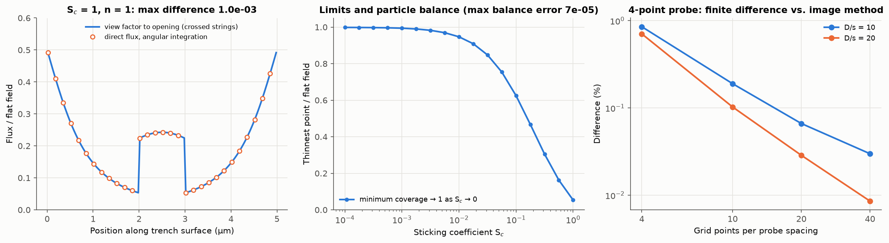

# 05. 증착 및 금속배선 (CVD, PVD, Metallization) 시뮬레이션

## 1. 목적

ISRC 반도체 기본공정교육에서는 HDPCVD와 PVD(스퍼터링)로 막을 증착하고, 금속 박막의 두께를 Alpha-step으로, 면저항을 4-point probe로 측정했습니다. 이 모듈에서는 다음 네 가지를 계산합니다.

1. **CVD 성장 속도**: 표면 반응과 기체 물질 전달 중 무엇이 속도를 정하는지, 그리고 그에 따라 웨이퍼 간 균일도가 무엇에 좌우되는지 계산합니다.
2. **단차 피복(step coverage)**: 트렌치 안에서 증착 두께가 위치마다 어떻게 달라지는지, 증착 방법별 입사각 분포와 부착 확률로 계산합니다.
3. **4-point probe 면저항 측정**: 실습에서 측정한 방법을 그대로 모델링해, 시료 크기와 측정 위치에 따른 보정 계수를 구합니다.
4. **배선 RC 지연**: Al/SiO₂에서 Cu/low-k로 바뀐 이유를 정량적으로 비교합니다.

## 2. 모델

### 2.1 CVD: Grove 모델 (Plummer Ch. 9)

반응 기체는 경계층을 지나 표면에 도달하고(물질 전달 계수 h_G), 표면에서 반응합니다(반응 속도 상수 k_s). 두 과정이 직렬이므로 성장 속도는

$$v = \frac{k_s h_G}{k_s + h_G}\,\frac{C_T}{N}\,Y, \qquad k_s = k_0\, e^{-E_a/kT}$$

입니다. k_s ≪ h_G이면 반응 율속(온도에 민감), h_G ≪ k_s이면 물질 전달 율속(기체 흐름과 장비 형상에 민감)입니다. 활성화 에너지는 교재의 Si 증착 값 1.6 eV를 사용했고, 상압(760 torr)에서 두 항이 같아지는 전이 온도는 1100 °C로 가정했습니다. 저압에서는 확산계수 D_G가 압력에 반비례하고 경계층은 약 7배 두꺼워지므로, 1 torr에서 h_G는 약 760/7 ≈ 109배가 됩니다(교재: 약 100배).

### 2.2 단차 피복: 입사각 분포와 재방출

교재의 증착 모델을 따라, 트렌치 안의 각 위치가 받는 플럭스를 직접 도달하는 성분과 다른 면에서 튕겨 나온 성분의 합으로 계산합니다.

$$F_i = F_{direct,i} + \sum_k V_{ik}\,(1 - S_c)\,F_k, \qquad \text{증착 속도} \propto S_c F_i$$

- **직접 플럭스**: 입구 위에서 cosⁿθ 분포로 들어오는 입자 중, 트렌치 벽에 가리지 않고 그 위치에 닿는 양을 입체각 적분으로 계산합니다.
- **재방출**: 붙지 않은 입자(1 − S_c)는 들어온 방향과 관계없이 cos 분포로 다시 튀어 나갑니다. 표면 요소 사이의 view factor V_ik는 2D 단면에서 정확한 crossed-string 방법으로 계산했습니다.
- **트렌치**: 깊이 방향으로 무한히 긴 홈(2D 단면)입니다. 직사각형 내부는 서로 가리지 않으므로 view factor를 그대로 쓸 수 있습니다.

증착 방법별 n과 S_c는 교재의 표(Plummer Ch. 9)에서 범위의 대표값을 사용했습니다.

| 증착 방법 | n | S_c (교재 범위) | 사용 값 |
|---|---|---|---|
| 스퍼터링 | 1~4 | 약 1 | n = 1, S_c = 1 |
| 콜리메이트/이온화 PVD | 8~80 | 약 1 | n = 20, S_c = 1 |
| LPCVD SiO₂ (silane) | 1 | 0.2~0.4 | 0.3 |
| LPCVD SiO₂ (TEOS) | 1 | 0.05~0.1 | 0.075 |
| LPCVD W | 1 | 0.01 이하 | 0.01 |
| LPCVD poly-Si | 1 | 0.001 이하 | 0.001 |

### 2.3 4-point probe

일직선으로 놓인 네 탐침 중 바깥 두 개로 전류 I를 흘리고 안쪽 두 개의 전압 V를 재면, 무한히 넓은 박막에서 면저항은 $R_s = \frac{\pi}{\ln 2}\frac{V}{I} = 4.532\,\frac{V}{I}$입니다. 시료가 유한하면 가장자리에서 전류가 빠져나가지 못하므로 보정 계수 CF = R_s/(V/I)가 달라집니다. 원형 시료는 가장자리 바깥의 반전점 a²/z̄에 같은 부호의 영상 전류원을 두면 경계 조건이 정확히 만족되므로(영상법), 탐침이 시료 중심에서 벗어난 경우까지 닫힌 식으로 계산했습니다.

### 2.4 배선 RC 지연 (Plummer Ch. 11)

$$\tau = 0.89\,RC = 0.89\,K_I K_{ox}\,\varepsilon_0\,\rho\,L^2\left(\frac{1}{H x_{ox}} + \frac{1}{W L_S}\right)$$

ρ는 배선 비저항, L은 길이, W와 H는 배선 폭과 두께, x_ox는 아래 절연막 두께, L_S는 옆 배선과의 간격, K_ox는 절연막 유전 상수입니다. 가장자리 전계 보정 K_I는 1로 두었습니다.

## 3. 결과

### 3.1 CVD: 반응 율속과 물질 전달 율속



| 장비 | 온도 | +1 °C당 성장 속도 변화 | 가스 흐름(h_G) +10 %당 변화 |
|---|---|---|---|
| APCVD | 700 °C | 1.95 % | 0.04 % |
| APCVD | 1100 °C | 0.49 % | 4.98 % |
| LPCVD | 700 °C | 1.96 % | 0.00 % |
| LPCVD | 1100 °C | 0.98 % | 0.09 % |

- 저압에서 h_G가 약 109배 커지면 전이 온도는 1100 °C에서 약 1830 °C로 올라갑니다. **실제 LPCVD 공정 온도에서는 항상 반응 율속**입니다.
- 반응 율속에서는 가스 흐름과 웨이퍼 배치의 영향이 거의 사라지므로, 웨이퍼를 세워서 촘촘히 쌓는 hot-wall 퍼니스로 한 번에 많은 웨이퍼를 처리할 수 있습니다. 교재가 설명한 LPCVD의 장점을 수치로 확인한 결과입니다.
- 대신 온도에는 민감합니다. 700 °C에서 1 °C 차이가 성장 속도를 약 2 % 바꾸므로, 두께 균일도 ±1 %를 맞추려면 웨이퍼 사이 온도 차를 ±0.5 °C 안으로 관리해야 합니다.

### 3.2 단차 피복



종횡비 2인 트렌치에서 평평한 윗면 대비 증착 두께입니다.

| 증착 방법 | 바닥 중앙 | 측벽 위 | 측벽 중간 | 측벽 아래 | 최소 |
|---|---|---|---|---|---|
| 스퍼터 (n = 1, S_c = 1) | 0.24 | 0.49 | 0.14 | 0.05 | 0.05 |
| 콜리메이트 PVD (n = 20) | 0.73 | 0.09 | 0.09 | 0.08 | 0.08 |
| LPCVD SiO₂, silane (S_c = 0.3) | 0.45 | 0.67 | 0.40 | 0.32 | 0.32 |
| LPCVD SiO₂, TEOS (S_c = 0.075) | 0.75 | 0.86 | 0.74 | 0.69 | 0.69 |
| LPCVD W (S_c = 0.01) | 0.96 | 0.98 | 0.96 | 0.95 | 0.95 |

- **스퍼터링**은 측벽 위쪽(0.49)이 아래쪽(0.05)보다 약 9배 두껍게 쌓입니다. 입구 쪽이 먼저 두꺼워지며 튀어나오는 overhang이 생기고, 계속 증착하면 입구가 먼저 막혀 내부에 빈 공간(void)이 남습니다.
- **silane과 TEOS**를 비교하면 측벽 위아래 두께 비가 2.1배에서 1.2배로 줄어듭니다. 교재가 TEOS 산화막이 silane보다 cusping이 적다고 설명한 것과 같은 결과입니다.
- **W(S_c = 0.01)** 는 거의 균일하게 덮여, 접촉 구멍과 via를 채우는 데 LPCVD W가 쓰이는 이유를 보여줍니다.



| 최소 피복률 | S_c = 1 | 0.3 | 0.075 | 0.01 | 0.001 |
|---|---|---|---|---|---|
| 종횡비 1 | 0.15 | 0.51 | 0.82 | 0.97 | 1.00 |
| 종횡비 2 | 0.05 | 0.32 | 0.69 | 0.95 | 0.99 |
| 종횡비 4 | 0.02 | 0.15 | 0.48 | 0.89 | 0.99 |

- 입자가 여러 번 튕길수록(S_c가 작을수록) 트렌치 안의 플럭스가 고르게 분포해 피복이 균일해집니다. 종횡비가 커질수록 같은 피복률을 얻는 데 더 작은 S_c가 필요합니다.
- 오른쪽 그래프는 PVD에서 입사각 분포를 좁힌 경우입니다. n이 커지면 바닥은 0.24에서 0.97까지 두꺼워지지만 측벽은 0.14에서 0.05로 얇아집니다. 가장 얇은 곳의 두께는 n = 8에서 최대 0.09에 그칩니다. **교재의 결론처럼, 균일한 피복에는 입사각 분포를 바꾸는 것보다 부착 확률을 낮추는 것이 훨씬 효과적**입니다. 콜리메이트 PVD는 바닥 피복이 중요한 접촉 구멍의 barrier와 seed 층에 맞는 방법입니다.

### 3.3 4-point probe 보정 계수



| 시료 (탐침 간격 1 mm) | 탐침 중심 위치 | 보정 계수 | 4.532를 그대로 쓸 때 R_s 오차 |
|---|---|---|---|
| 100 mm 웨이퍼 | 중심 | 4.528 | +0.1 % |
| 100 mm 웨이퍼 | 반지름의 87 % | 4.465 | +1.5 % |
| 100 mm 웨이퍼 | 반지름의 92 % | 4.368 | +3.8 % |
| 20 mm 조각 | 중심 | 4.436 | +2.2 % |
| 20 mm 조각 | 반지름의 76 % | 4.018 | +12.8 % |

- 웨이퍼 중심에서는 무한 박막 보정 계수 4.532를 그대로 써도 오차가 0.1 %로 무시할 수 있습니다.
- 그러나 웨이퍼 가장자리 근처나 작은 조각 시료에서는 오차가 수 %에서 수십 %까지 커집니다. 전류가 가장자리 밖으로 퍼지지 못하고 탐침 근처에 몰려 전압이 커지므로, 보정하지 않으면 **면저항을 실제보다 크게** 읽습니다. 웨이퍼 면저항 맵을 그릴 때 가장자리 측정점은 보정하거나 제외해야 하는 이유입니다.
- 실습의 측정 흐름에 적용하면, Al 박막의 비저항을 교재 값 3 µΩ·cm로 볼 때 두께 500 nm에서 R_s는 60 mΩ/sq입니다. 반대로 측정한 R_s와 Alpha-step 두께를 곱하면 비저항(ρ = R_s × t)을 구할 수 있습니다.

### 3.4 배선 RC 지연



폭, 두께, 절연막 두께, 배선 간격이 모두 1 µm인 10 mm 전역 배선에서 계산했습니다.

| 배선 / 절연막 | 비저항 | 유전 상수 | 지연 | Al/SiO₂ 대비 |
|---|---|---|---|---|
| Al / SiO₂ | 3.0 µΩ·cm | 3.9 | 184 ps | 100 % |
| Cu / SiO₂ | 2.2 µΩ·cm | 3.9 | 135 ps | 73 % |
| Cu / low-k | 2.2 µΩ·cm | 2.7 | 94 ps | 51 % |

- 지연은 길이의 제곱에 비례하므로 칩이 커지고 배선이 길어질수록 빠르게 늘어납니다. 같은 길이에서 poly-Si 배선은 Al보다 약 170배 느려, poly-Si와 실리사이드는 짧은 국부 배선에만 씁니다.
- 배선 금속을 Cu로, 절연막을 low-k로 바꾸면 지연이 절반 가까이 줄어듭니다. Cu는 식각 부산물이 휘발되지 않아 건식 식각이 어렵기 때문에, 절연막에 홈을 먼저 파고 Cu를 채운 뒤 CMP로 평탄화하는 damascene 공정이 함께 도입되었습니다(Plummer Ch. 11).
- 1 µm × 1 µm 배선에 교재가 electromigration 문제가 생긴다고 한 전류 밀도 0.1~0.5 MA/cm²를 적용하면, 허용 전류는 1~5 mA입니다.

## 4. 검증



| 항목 | 비교 대상 | 결과 |
|---|---|---|
| 트렌치 내부 view factor | 합 법칙: 모든 요소와 입구로의 view factor 합 = 1 | 오차 1 × 10⁻¹³ |
| 직접 플럭스 (n = 1) | 입구로의 view factor (crossed-string) | 최대 차이 1 × 10⁻³ |
| 바닥 중앙 (S_c = 1, n = 1) | 해석해 sin(arctan(w/2h)) | 0.2 % 이내 |
| 입자 수지 | 입구로 들어온 입자 = 붙은 입자 + 빠져나간 입자 | 오차 7 × 10⁻⁵ |
| S_c → 0 극한 | 완전히 균일한 피복 | S_c = 10⁻⁴에서 최소 피복률 0.998 |
| 4-point probe (중심) | Smits(1958) 닫힌 식 | 10자리까지 일치 |
| 4-point probe (중심, 가장자리 근처) | 유한차분 수치해 | 격자를 늘리면 차이가 0.85 % → 0.03 %로 감소 |
| RC 지연 | R과 C를 따로 계산한 0.89 RC | 일치 |
| LPCVD h_G 증가 | 교재: 약 100배 | 109배 |

4-point probe 보정 계수는 서로 독립적인 세 방법(교재와 측정 표준에서 쓰는 Smits 식, 영상법, 유한차분)이 모두 일치해, 탐침이 중심에서 벗어난 경우의 영상법 결과도 신뢰할 수 있습니다.

자동 테스트는 이 모듈에서 38개, 전체 145개입니다.

## 5. 한계와 다음 단계

- **단차 피복은 증착 초기의 분포**: 막이 쌓이며 트렌치 모양이 바뀌는 과정(overhang 성장, void 형성)은 계산하지 않았습니다. 04 모듈의 level set과 결합하면 시간에 따른 형상 변화와 void 형성 시점을 계산할 수 있습니다.
- **2D 트렌치**: 원형 접촉 구멍(3D)에서는 같은 종횡비라도 피복이 더 나빠집니다.
- **HDPCVD의 스퍼터링 미반영**: 증착과 동시에 일어나는 각도 의존 스퍼터링(overhang 제거)은 포함하지 않았습니다.
- **CVD 전이 온도는 가정값**: 실제 값은 기체 종류와 장비에 따라 다르며, 결론(LPCVD는 반응 율속)은 전이 온도 가정에 크게 의존하지 않습니다.
- **배선 모델 단순화**: 가장자리 전계, 배선 폭이 좁아질 때 커지는 비저항(표면과 결정립계 산란), barrier 층의 저항은 포함하지 않았습니다.

## 6. 재현 방법

```bash
.venv/bin/python -m pytest
.venv/bin/python scripts/run_deposition.py
```

## 참고 문헌

1. J. D. Plummer, M. D. Deal, and P. B. Griffin, *Silicon VLSI Technology: Fundamentals, Practice and Modeling*, Prentice Hall (2000), Ch. 9 (Thin Film Deposition), Ch. 11 (Backend Technology). 강의 슬라이드: [Ch. 9](http://apachepersonal.miun.se/~gorthu/Plummer/Material/Plummer/0130407836_ppt09.pdf), [Ch. 11](http://apachepersonal.miun.se/~gorthu/Plummer/Material/Plummer/0130407836_ppt11.pdf).
2. F. M. Smits, "Measurement of Sheet Resistivities with the Four-Point Probe," *Bell Syst. Tech. J.* 37, 711 (1958).
3. H. C. Hottel and A. F. Sarofim, *Radiative Transfer*, McGraw-Hill (1967). (2D view factor의 crossed-string 방법)
