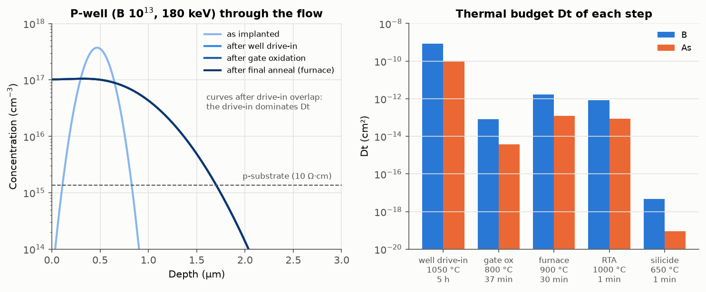
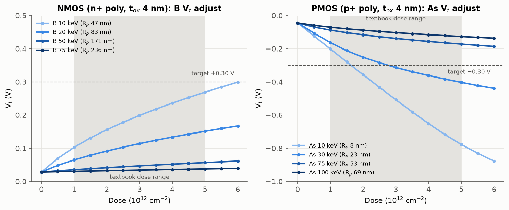
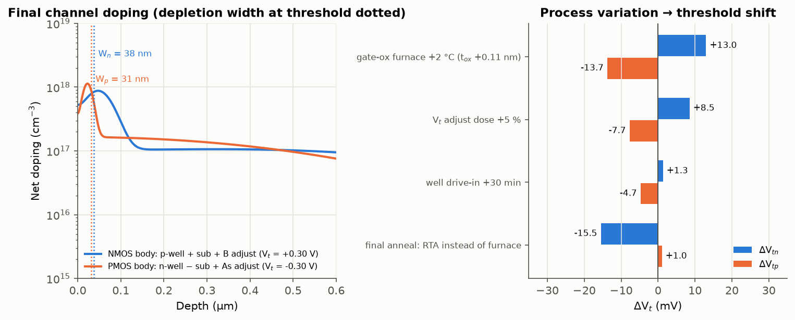
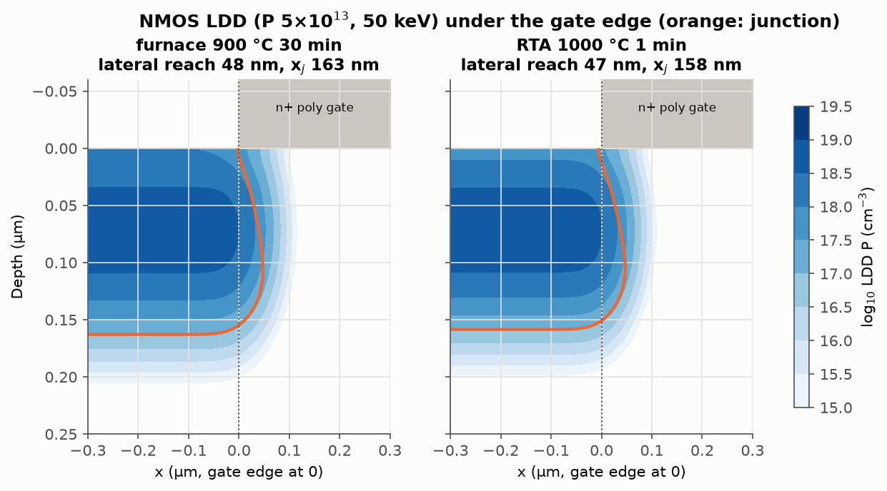
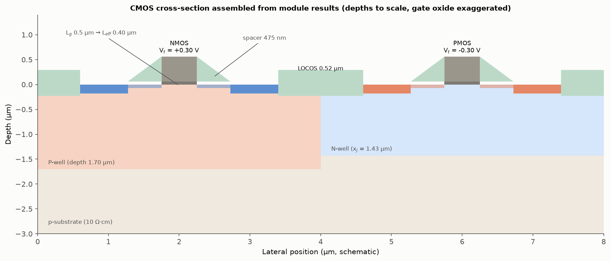
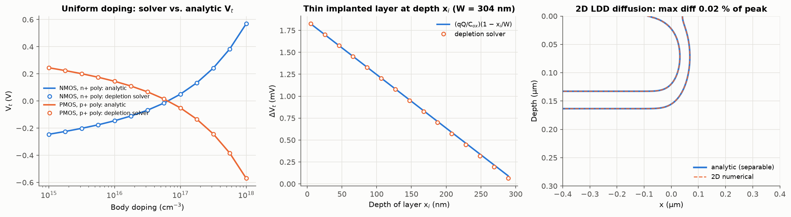

# 06. 공정 통합 (Process Integration) 시뮬레이션

## 1. 목적

ISRC 반도체 기본공정교육에서는 단위 공정을 차례로 진행해 CMOS 소자를 만들었습니다. 01~05 모듈은 단위 공정을 따로 다뤘고, 이 모듈에서는 그 결과를 실제 공정 순서대로 연결합니다. 교재(Plummer Ch. 2)가 요약에서 강조하듯, 단위 공정은 따로 공부하지만 실제 제조에서는 각 단계가 앞뒤 공정과 맞물려야 전체 흐름이 동작합니다.

1. 교재의 CMOS 공정 흐름과 대표 조건을 01~05 모듈로 계산해, 모듈이 교재의 대표 결과를 재현하는지 확인합니다.
2. 뒤 공정의 열처리가 앞에서 넣은 도펀트 분포를 어떻게 바꾸는지(누적 thermal budget) 계산합니다.
3. 최종 도핑 분포로 NMOS와 PMOS의 문턱전압(V_t)을 계산하고, 목표 V_t를 맞추는 주입 조건과 공정 변동에 대한 민감도를 구합니다.
4. LDD 접합이 게이트 아래로 파고드는 거리를 2D로 계산해 유효 채널 길이(L_eff)를 구합니다.

## 2. 공정 흐름과 조건

교재의 CMOS 공정 흐름(16 mask, 100단계 이상)에서 소자 특성을 정하는 단계를 골라, 교재의 대표 범위 안에서 조건을 정했습니다.

| 단계 | 교재 대표 조건 | 이 모듈의 조건과 계산 결과 | 사용 모듈 |
|---|---|---|---|
| 기판 | p형 (100), 5~50 Ω·cm | 10 Ω·cm → N_A = 1.36 × 10¹⁵ cm⁻³ | 02 (Masetti 이동도) |
| LOCOS 필드 산화 | 90 min @ 1000 °C H₂O → 약 0.5 µm | 0.52 µm (Si 0.23 µm 소모) | 01 |
| Well | B, P 10¹³; drive-in 4~6 h @ 1000~1100 °C | 5 h @ 1050 °C → N-well 접합 1.43 µm, P-well 1.70 µm | 02 |
| 게이트 산화 | 3~5 nm, 0.5~1 h @ 800 °C O₂ | 4 nm → 37 min @ 800 °C | 01 (Massoud) |
| V_t 조절 주입 | B / As 1~5 × 10¹², 50~100 keV | B 10 keV 6.0 × 10¹², As 30 keV 2.8 × 10¹² → V_t +0.30 / −0.30 V | 02 + 06 |
| 게이트 노광 | - | L_g 0.5 µm, i-line NA 0.5: k₁ 0.68, DOF ±0.73 µm | 03 |
| Poly 식각 | 비등방성 플라즈마 식각, poly 0.5 µm | 게이트 산화막 손실 ≤ 2 nm에 선택비 111 이상 (과식각 20 %) | 04 |
| Spacer | 등각 SiO₂ 0.5 µm + 비등방성 식각 | TEOS 측벽 피복률 0.95 → spacer 475 nm | 05 + 04 |
| LDD + 최종 열처리 | P/B 5 × 10¹³ @ 50 keV; 900 °C 30 min 또는 RTA 1000 °C 1 min | L_eff 0.40 µm (furnace), 0.41 µm (RTA) | 02 + 06 |
| S/D | As 2~4 × 10¹⁵ @ 75 keV, B 1~3 × 10¹⁵ @ 50 keV | As 3 × 10¹⁵: R_p 53 nm, 최대 농도 5.7 × 10²⁰ cm⁻³ | 02 |
| 접촉 W 채움 | TiN barrier + W CVD | W (S_c 0.01) 종횡비 2에서 최소 피복률 0.95 | 05 |
| 금속 1 | Al 스퍼터링 + 플라즈마 식각 | Al 0.5 µm: R_s 60 mΩ/sq, 10 mm 배선 지연 184 ps | 05 |

게이트는 NMOS에 n+ poly, PMOS에 p+ poly를 쓰는 dual-poly 구조로 가정했습니다. N-well 주입 에너지는 교재가 300 keV 이상을 제시하지만, 02 모듈의 비정 표가 200 keV까지라 200 keV로 계산했습니다.

## 3. 결과

### 3.1 교재 대표 조건의 재현

| 항목 | 교재 | 이 프로젝트 |
|---|---|---|
| LOCOS: 90 min @ 1000 °C, H₂O | 약 0.5 µm | 0.52 µm |
| 게이트 산화: 0.5~1 h @ 800 °C, O₂ | 3~5 nm | 3.4~5.6 nm |
| 기판 5~50 Ω·cm | - | N_A = 2.8 × 10¹⁵ ~ 2.7 × 10¹⁴ cm⁻³ |

01 모듈의 산화 모델이 교재 공정 흐름의 대표 결과를 그대로 재현합니다. 모듈을 연결하기 전에 각 모듈이 실제 공정 조건에서 맞는 값을 주는지 확인한 단계입니다.

### 3.2 누적 열처리



| 단계 | B의 Dt | 확산 길이 2√(Dt) | As의 Dt |
|---|---|---|---|
| Well drive-in 1050 °C 5 h | 8.4 × 10⁻¹⁰ cm² | 580 nm | 1.1 × 10⁻¹⁰ cm² |
| 게이트 산화 800 °C 37 min | 8.2 × 10⁻¹⁴ cm² | 5.7 nm | 3.8 × 10⁻¹⁵ cm² |
| 최종 열처리 furnace 900 °C 30 min | 1.7 × 10⁻¹² cm² | 26 nm | 1.2 × 10⁻¹³ cm² |
| 최종 열처리 RTA 1000 °C 1 min | 8.4 × 10⁻¹³ cm² | 18 nm | 8.8 × 10⁻¹⁴ cm² |
| Silicide 650 °C 1 min | 4.7 × 10⁻¹⁸ cm² | 0.04 nm | 9.1 × 10⁻²⁰ cm² |

- Well 분포는 drive-in이 사실상 전부 결정합니다. 이후 단계의 Dt는 drive-in의 0.2 % 이하라 well 분포는 거의 변하지 않습니다.
- 반대로 V_t 조절 주입처럼 drive-in 뒤에 넣는 얕은 도펀트에게는 최종 열처리(확산 길이 18~26 nm)가 분포를 정하는 주요 단계입니다. 같은 열처리가 도펀트를 언제 넣었는지에 따라 무시할 만하기도 하고 결정적이기도 합니다. **고온 공정을 앞쪽에 배치하고 뒤쪽 공정의 열처리를 줄이는 이유**입니다.

### 3.3 문턱전압 설계



V_t는 문턱에서 표면 전위가 2φ_F가 될 때의 공핍 전하로 계산했습니다(공핍 근사, 불균일 도핑). 결과는 주입 깊이에 따라 크게 달라졌습니다.

| 주입 | R_p | 2 × 10¹²에서의 V_t 변화 | 목표 |V_t| 0.30 V에 필요한 dose |
|---|---|---|---|
| NMOS B 10 keV | 47 nm | +0.13 V | 6.0 × 10¹² |
| NMOS B 50 keV | 171 nm | +0.01 V | 범위 밖 |
| PMOS As 10 keV | 8 nm | −0.31 V | 약 1.6 × 10¹² |
| PMOS As 30 keV | 23 nm | −0.21 V | 2.8 × 10¹² |

- **공핍 영역 안 깊이 x_i에 넣은 전하는 (1 − x_i/W)만큼만 V_t를 바꿉니다.** 깊이 넣은 전하가 만드는 전위만큼 공핍 폭이 줄어 기판 쪽 공핍 전하가 그만큼 빠지기 때문입니다(4장 검증). 4 nm 게이트 산화막에서는 문턱의 공핍 폭이 30~40 nm로 얕아서, 교재의 에너지(B 50~75 keV, R_p 170~240 nm)로 넣은 B는 대부분 공핍 영역 밖에 놓여 V_t를 거의 바꾸지 못합니다.
- B는 가벼워서 같은 에너지에서 As보다 4~6배 깊이 들어갑니다. 10 keV까지 낮춰도 NMOS는 목표에 교재 범위보다 많은 6.0 × 10¹²가 필요했습니다. 얕은 p형 주입에 B 대신 무거운 BF₂ 분자 이온을 쓰는 이유와 같은 맥락입니다.
- **게이트 산화막이 얇아질수록 V_t 조절 주입도 함께 얕아져야 합니다.** 단위 공정 조건을 따로 정하면 맞지 않고, 산화 모듈과 주입 모듈을 함께 봐야 정해지는 공정 통합의 예입니다.

### 3.4 공정 변동과 V_t 민감도



| 공정 변동 | ΔV_tn | ΔV_tp |
|---|---|---|
| 게이트 산화로 온도 +2 °C (산화막 +0.11 nm) | +13.0 mV | −13.7 mV |
| V_t 조절 dose +5 % | +8.5 mV | −7.7 mV |
| Well drive-in +30 min | +1.3 mV | −4.7 mV |
| 최종 열처리를 furnace 대신 RTA | −15.5 mV | +1.0 mV |

- 게이트 산화로 온도가 2 °C 높으면 같은 시간에 산화막이 0.11 nm(약 3 %) 두꺼워지고, V_t가 13 mV 바뀝니다. **dose를 5 % 틀린 것보다 영향이 큽니다.** 01 모듈에서 얇은 산화막은 반응 율속이라 온도에 민감하다고 정리한 내용이 소자 특성으로 이어지는 경로입니다.
- 최종 열처리를 RTA로 바꾸면 NMOS V_t가 15 mV 낮아집니다. 확산이 덜 일어나 얕은 B 분포가 더 좁게 남고, 공핍 영역 안의 B 전하 분포가 바뀌기 때문입니다. PMOS의 As는 확산이 느려 거의 영향이 없습니다.
- 모든 변동이 수~십수 mV 수준이므로, 실제 양산에서는 이런 변동을 합친 V_t 산포를 관리 규격과 비교해 공정 조건별 관리 범위를 정합니다.

### 3.5 LDD 측면 확산과 유효 채널 길이



| 최종 열처리 | P의 Dt | 게이트 아래 측면 침투 | LDD 접합 깊이 | L_eff (L_g 0.5 µm) |
|---|---|---|---|---|
| furnace 900 °C 30 min | 1.3 × 10⁻¹² cm² | 48 nm | 163 nm | 0.40 µm |
| RTA 1000 °C 1 min | 7.6 × 10⁻¹³ cm² | 47 nm | 159 nm | 0.41 µm |

- 게이트 모서리에 맞춰 주입한 LDD는 양쪽에서 약 47~48 nm씩 게이트 아래로 들어가 유효 채널 길이가 0.5 µm에서 0.40 µm로 20 % 줄어듭니다.
- 두 열처리의 Dt 차이(약 1.7배)에 비해 측면 침투 차이가 1 nm로 작은 것은, 주입 직후의 측면 퍼짐(측면 straggle)이 확산 길이보다 크기 때문입니다. 이 결과는 측면 straggle을 깊이 방향 ΔR_p와 같다고 둔 가정에 영향을 받습니다(5장).

### 3.6 모듈 결과로 조립한 CMOS 단면



깊이 방향 치수(LOCOS 두께와 Si 소모, well 깊이, poly 두께, spacer 폭)는 모두 계산값이고, 게이트 산화막은 보이도록 두껍게 그렸습니다.

### 3.7 다른 모듈과 연결해 확인한 공정 조건

- **Poly 식각 선택비**: 04 모듈의 과식각 계산에서 10 nm 게이트 산화막은 선택비 27이면 충분했지만, 4 nm 산화막에서 손실을 절반(2 nm) 이하로 유지하려면 선택비가 111 이상 필요합니다. 게이트 산화막이 얇아지면 식각 공정의 요구 조건이 함께 강화됩니다.
- **Spacer 폭**: 05 모듈의 단차 피복 계산으로 TEOS 산화막이 poly 측벽에 0.95배 두께로 쌓여, 비등방성 식각 후 spacer 폭이 약 475 nm가 됩니다. 이 폭이 S/D 주입과 채널 사이의 거리를 정합니다.
- **게이트 노광**: 0.5 µm 게이트는 i-line(NA 0.5)에서 k₁ 0.68로 03 모듈의 레지스트 기준 한계(k₁ ≈ 0.40)보다 여유가 있습니다.

## 4. 검증



| 항목 | 비교 대상 | 결과 |
|---|---|---|
| 불균일 도핑 V_t 계산기 | 균일 도핑 해석해 (NMOS n+ poly, PMOS p+ poly, 10¹⁵~10¹⁸ cm⁻³) | 차이 5 × 10⁻⁷ V |
| 표면 주입 | ΔV_t = qQ/C_ox | 일치 (0.1 % 이내) |
| 깊이 x_i의 얇은 주입층 | ΔV_t = (qQ/C_ox)(1 − x_i/W) | qQ/C_ox의 1.5 % 이내 |
| LDD 2D 확산 해석해 | 2D 수치해 (깊이, 측면 방향 Crank-Nicolson) | 최대 농도의 0.02 % 이내 |
| LOCOS, 게이트 산화막 | 교재 대표 결과 | 0.52 µm (교재 약 0.5 µm), 3.4~5.6 nm (교재 3~5 nm) |

자동 테스트는 이 모듈에서 24개, 전체 169개입니다.

## 5. 한계

- **장채널 V_t**: 짧은 채널 효과(V_t roll-off, DIBL), poly 공핍, 양자 효과, 산화막 고정 전하는 포함하지 않았습니다. L_eff 0.4 µm에서는 짧은 채널 효과가 작지만, 더 짧은 게이트에는 2D 소자 시뮬레이션이 필요합니다.
- **진성 확산만 반영**: 02 모듈과 같은 한계로, S/D처럼 고농도인 영역의 확산과 산화 중 확산 증가(OED), 주입 손상에 의한 일시적 확산 증가(TED), 산화 시 B가 산화막으로 빠져나가는 분리(segregation)는 포함하지 않았습니다. 그래서 S/D 접합 깊이는 계산하지 않았습니다.
- **측면 straggle 가정**: 측면 straggle을 ΔR_p와 같다고 두었습니다. L_eff는 이 가정에 영향을 받습니다.
- **형상 단순화**: LOCOS의 bird's beak, spacer의 실제 단면 형상, silicide 형성은 모델링하지 않았고, 단면 그림은 계산한 치수로 그린 개략도입니다.
- **공정 조건 일부 가정**: dual-poly 게이트, N-well 200 keV(교재 300 keV 이상), V_t 목표 ±0.30 V는 이 모듈에서 정한 시나리오입니다.

## 6. 재현 방법

```bash
.venv/bin/python -m pytest
.venv/bin/python scripts/run_integration.py
```

## 참고 문헌

1. J. D. Plummer, M. D. Deal, and P. B. Griffin, *Silicon VLSI Technology: Fundamentals, Practice and Modeling*, Prentice Hall (2000), Ch. 2 (Modern CMOS Technology). 강의 슬라이드: [Ch. 2](http://apachepersonal.miun.se/~gorthu/Plummer/Material/Plummer/0130407836_ppt02.pdf).
2. S. M. Sze and K. K. Ng, *Physics of Semiconductor Devices*, 3rd ed., Wiley (2007). (MOS 문턱전압, 300 K 실리콘 상수)
3. 이 프로젝트의 01~05 모듈 보고서.
